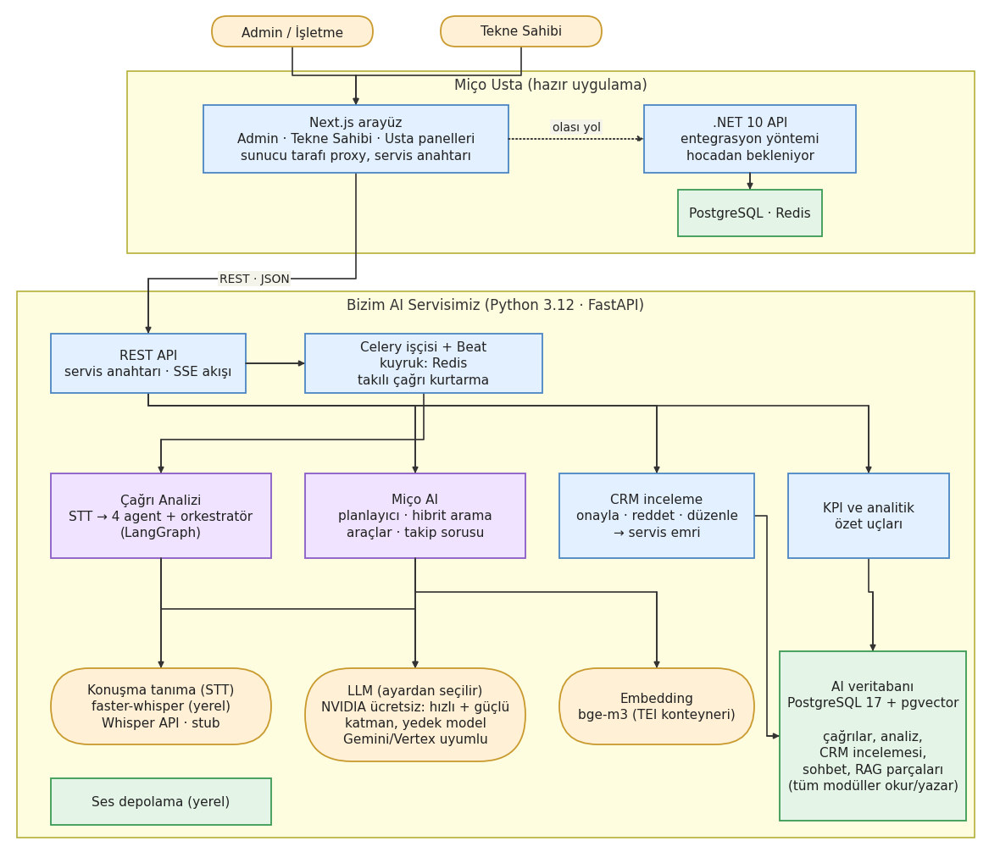
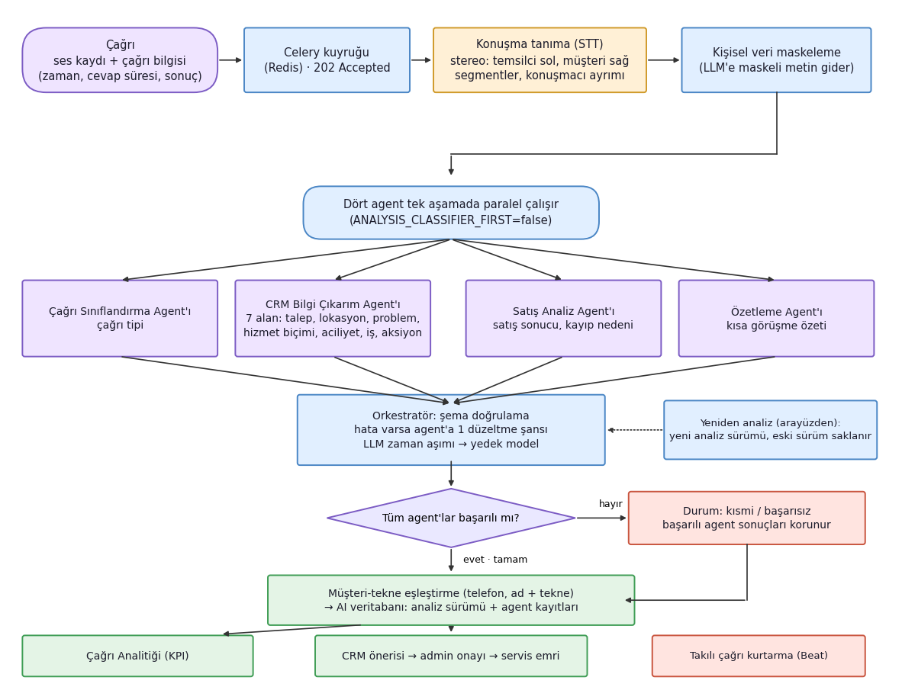
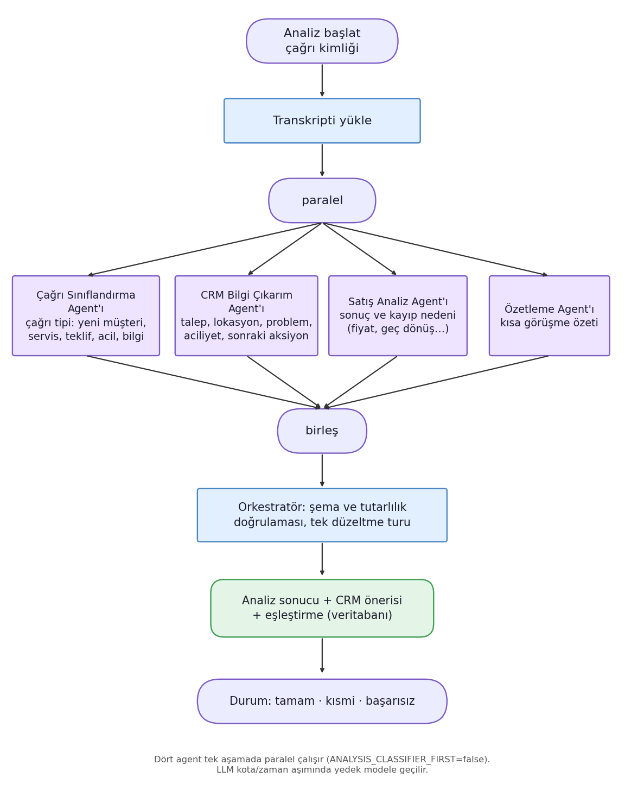
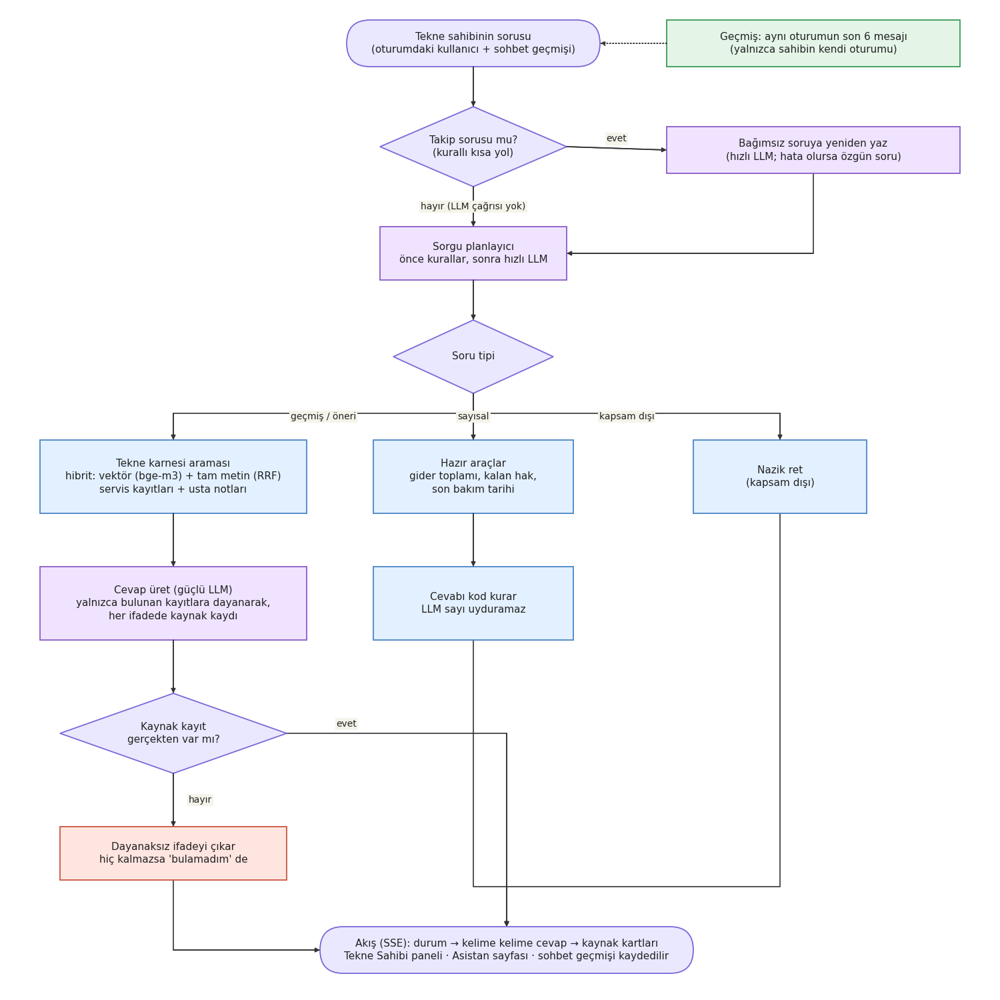
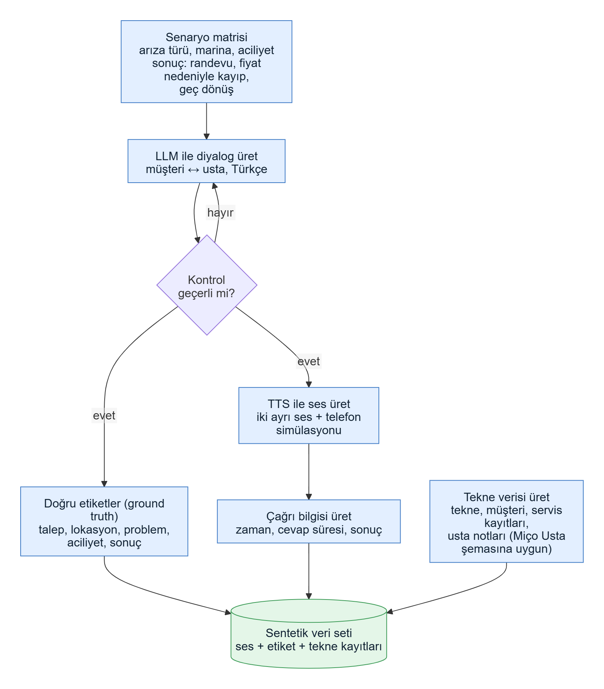
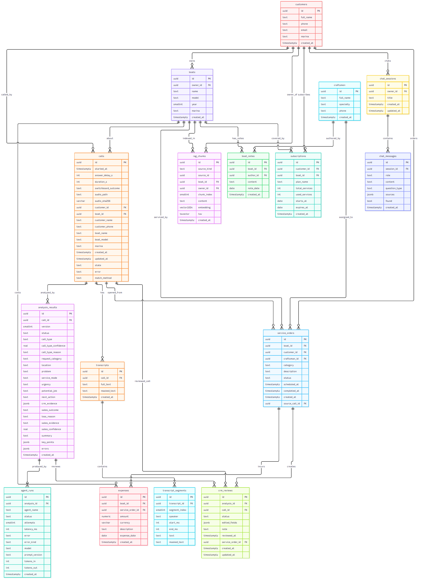

# Miço Usta Call Analytics and Miço AI

[🇹🇷 Türkçe](README.md) · 🇬🇧 English

Istanbul Gedik University, MFK420 Graduation Project. An AI-powered call analytics and boat-owner assistant system for **Miço Usta**, a boat maintenance and service company. It automatically analyses phone calls, turns them into CRM records and KPIs, and answers boat owners' questions from their own data.

**Team:** Berkay Öztürk (AI, agents, RAG) · Ahmet Aydın (frontend) · Melih Uyanık (backend, data)

> All data is **synthetic**; there is no real customer data. Text sent to the LLM is stripped of personal data.
>
> The project documentation under `docs/` and the architecture document are written in Turkish; this README is the English entry point.

## Contents

- [What it does](#what-it-does)
- [Architecture](#architecture)
- [Tech stack](#tech-stack)
- [Quick start](#quick-start)
- [Configuration](#configuration)
- [Repository layout](#repository-layout)
- [Testing and quality](#testing-and-quality)
- [Measured results](#measured-results)
- [Security and privacy](#security-and-privacy)
- [Contribution workflow](#contribution-workflow)
- [Roadmap](#roadmap)
- [Documentation](#documentation)

## What it does

| # | Feature | User | In short |
|---|---|---|---|
| 1 | **Call → CRM record** | Admin | An audio file or transcript is uploaded; speech is transcribed and 4 agents extract 7 CRM fields. The admin approves, edits-and-approves, or rejects the suggestion; the first approval creates a service order. |
| 2 | **Call analytics** | Admin | Call counts, urgent calls, calls converted to sales and lost sales, most common faults, busiest marinas, reasons for lost sales; date and marina filters. |
| 3 | **Miço AI** | Boat owner | A chat assistant that answers from the owner's own boat record, jobs, expenses and subscription, **citing its sources**. Numbers are computed by code; the model never makes them up. |

**Highlights**

- Four agents run in parallel (call classifier, CRM extraction, sales analysis, summariser). Every output is validated against a schema, with one correction round on failure; if one agent crashes, the others' results are kept (the record completes as "partial").
- For stereo telephone recordings each channel is transcribed separately (agent on the left, customer on the right), which gives speaker separation.
- A call is automatically linked to a registered customer and boat by phone number or by name + boat name; otherwise the admin matches it manually.
- Analyses are versioned: re-analysis creates a new version and keeps the old ones; approvals are tied to an analysis version.
- Resilience: on an LLM timeout the system switches to a fallback model; calls that get stuck are recovered automatically.
- Miço AI: hybrid search (vector + full text, RRF), follow-up questions, word-by-word streaming (SSE), session history, and a grounding check that removes unsupported claims.
- Miço AI safety layer (no LLM involved): distinct, situation-specific replies for profanity, threats, self-harm, prompt-injection attempts, requests for other people's data, and gibberish.
- A boat owner only sees **their own** data; chat history is read only from their own session.

## Architecture



Users (admin and boat owner) use the Next.js interface. It calls the Python AI service (FastAPI) through a server-side proxy using a service key. Long jobs (speech → text, analysis, indexing) run in a Celery worker with Redis as the queue. The service uses speech recognition (STT), an LLM and an embedding service, and writes results to PostgreSQL (pgvector).

| Diagram | Content |
|---|---|
|  | Call analysis flow: audio → text → agents → CRM and KPIs |
|  | Agents and the LangGraph orchestrator |
|  | Miço AI flow: planning, retrieval, grounding |
|  | Synthetic call and boat data generation |
|  | Database ER diagram (17 tables) |

Detailed architecture, decisions and current status: [`Sistem_mimarisi_v5.md`](Sistem_mimarisi_v5.md) (Turkish).

## Tech stack

| Layer | Technology |
|---|---|
| Backend | Python 3.12, FastAPI, Pydantic, SQLAlchemy (async) + asyncpg, Alembic |
| Background jobs | Celery + Redis (Beat for periodic tasks) |
| Database | PostgreSQL 17 + pgvector |
| Agents | LangGraph + LangChain; the LLM provider is selected by configuration (NVIDIA Nemotron in development: fast + strong + fallback model) |
| Speech recognition | faster-whisper (local, CPU; `small` by default, `medium` is more accurate); Whisper API and a stub as alternatives |
| Embeddings | bge-m3 (TEI container), 1024 dimensions |
| Frontend | Next.js 16, React 19, TypeScript, Tailwind CSS |
| Tests | pytest (~1,430 tests), Playwright (e2e + accessibility/axe), ruff, mypy, ESLint |
| Infrastructure | Docker Compose, GitHub Actions |

## Quick start

Detailed guide and troubleshooting: [`docs/calistirma.md`](docs/calistirma.md) (Turkish).

### A) Whole system in Docker (one command)

No local Python or Node is needed, only Docker Desktop.

```bash
# From the repository root
docker compose -f infra/docker-compose.yml --profile app up -d
```

PostgreSQL and Redis start first; the `init` service applies the migrations and loads the 100-call synthetic dataset if the database is empty; then the API (`:8000`), the Celery worker and the web interface (`:3000`) start. To include the embedding service for Miço AI, pass `--profile app --profile rag`.

### B) Development setup (2 terminals)

Requirements: Docker Desktop, [uv](https://docs.astral.sh/uv/), Node.js 20+ (22 in CI).

```bash
# First-time setup (once)
cd backend
uv sync --extra ai --extra stt
cp .env.example .env          # Windows PowerShell: Copy-Item .env.example .env
cd ../frontend
npm install
cp .env.example .env.local    # Windows PowerShell: Copy-Item .env.example .env.local
```

Fill in at least `SERVICE_API_KEY` and `LLM_API_KEY` in `backend/.env`; `SERVICE_KEY` in `frontend/.env.local` must equal the backend's `SERVICE_API_KEY`.

```bash
# Terminal 1: backend (starts infrastructure, migration, seed, index, worker and API in one command)
cd backend
uv run python -m scripts.dev

# Terminal 2: frontend  →  http://localhost:3000
cd frontend
npm run dev
```

The first run can take a few minutes (the embedding model, ~2.3 GB, is downloaded); later starts take a few seconds.

> **Windows note:** use `127.0.0.1` instead of `localhost` in `REDIS_URL` (this is the default in `.env.example`). `localhost` resolves to IPv6 first, which adds ~2 s to every Redis connection.

## Configuration

All settings are read from `backend/.env` (`backend/.env.example` is commented). Common ones:

| Variable | Meaning |
|---|---|
| `SERVICE_API_KEY` | Service key between the web interface and the AI service (secret, never committed) |
| `LLM_PROVIDER`, `LLM_API_KEY`, `LLM_FAST_MODEL`, `LLM_SMART_MODEL`, `LLM_FALLBACK_MODEL` | LLM provider, key and models |
| `STT_PROVIDER`, `WHISPER_MODEL`, `STT_CHANNEL_LAYOUT`, `WHISPER_INITIAL_PROMPT` | Speech recognition: provider, model size, channel layout, domain vocabulary |
| `EMBEDDING_PROVIDER`, `TEI_URL` | Embedding service |
| `AUDIO_STORAGE_BACKEND` | Audio storage: `local` or `gcs` |
| `ANALYSIS_CLASSIFIER_FIRST` | If `true`, restores the older "classify first" ordering |

Never commit secrets to the code or the repository.

## Repository layout

```
backend/    FastAPI app (app/), Celery worker, Alembic migrations, scripts (scripts/), tests (tests/)
frontend/   Next.js app: admin panel (analytics, calls, CRM, service orders) and boat-owner panel (assistant), Playwright tests (e2e/)
infra/      docker-compose.yml (infrastructure + app profiles), smoke-test overlay
data/       Synthetic call transcripts, ground-truth labels (truth/), boat data
docs/       API contract, schema, measurement reports, run and deployment guides, diagrams
```

## Testing and quality

```bash
cd backend
uv run ruff check . && uv run ruff format --check .
uv run mypy app
uv run pytest                      # ~1,430 tests

cd ../frontend
npm run lint && npm run build
npm run e2e                        # Playwright (first: npx playwright install)
```

**CI (GitHub Actions):** Backend: change detection, ruff, mypy, pytest, dependency-pin consistency, Docker image build, security scan (pip-audit), an end-to-end smoke test with Docker Compose (API + Celery + DB + Redis), and a documentation-consistency test. Frontend: ESLint + build, Playwright e2e (Chromium), Docker image build. The `main` branch is protected by a ruleset; the `Backend CI sonucu` and `Frontend CI sonucu` checks are required.

## Measured results

On synthetic data with a real LLM (details under `docs/`, in Turkish):

| Measurement | Result | Source |
|---|---|---|
| CRM field accuracy (100 calls: 60 development, 40 untouched test) | **94%** overall on the test set; next action **92%** | [`docs/agent_dogrulugu.md`](docs/agent_dogrulugu.md) |
| Speech recognition (telephone audio, stereo) | WER 24.8% `small`, **15.4%** `medium` | [`docs/stt_karari.md`](docs/stt_karari.md) |
| Bulk analysis reliability | **55/55** valid calls completed without error | [`docs/dayaniklilik.md`](docs/dayaniklilik.md) |
| Miço AI chat quality (82 questions) | **95-98%** acceptable answers | [`docs/asistan_sohbet_olcumu.md`](docs/asistan_sohbet_olcumu.md) |
| Load (single process, 30 concurrent) | No errors; list endpoint ~52 requests/s | [`docs/guvenlik_yuk.md`](docs/guvenlik_yuk.md) |
| Analysis time | Four agents in parallel; LLM stage ~5 s | [`docs/analiz_sureleri.md`](docs/analiz_sureleri.md) |

## Security and privacy

- All data is synthetic; personal data is masked before it reaches the LLM.
- The web interface calls the AI service with a service key and attaches the boat owner's identity to each request. Authorization-matrix tests verify that one owner cannot reach another owner's data.
- Every claim in a Miço AI answer is backed by a record; unsupported claims are removed.
- Miço AI answers profanity, threats, self-harm, injection attempts and requests for other people's data without sending them to the LLM.

## Contribution workflow

No direct commits to `main`. Every piece of work goes on its own branch with a pull request; CI must be green and the PR approved. Commit messages and PR descriptions are written in Turkish; code and the database are in English, while the UI and LLM output are in Turkish.

## Roadmap

| Status | Item |
|---|---|
| Done | Call analysis, CRM approval flow, service orders, KPI screens, Miço AI, one-command Docker, CI |
| After the midterm | Sentiment-analysis agent; trying the embedding model through an API key; model-based speaker separation for mono recordings |
| Final | Integration into the Miço Usta application and deployment to Google Cloud ([`docs/canliya_alma.md`](docs/canliya_alma.md)) |

## Documentation

All documents below are in Turkish.

| Document | Content |
|---|---|
| [`Sistem_mimarisi_v5.md`](Sistem_mimarisi_v5.md) | Architecture, decisions, current status (v5) |
| [`docs/db_schema.md`](docs/db_schema.md) | Database schema and ER diagram |
| [`docs/api.md`](docs/api.md) | API contract |
| [`docs/enums.md`](docs/enums.md) | Field value lists |
| [`docs/agent_dogrulugu.md`](docs/agent_dogrulugu.md) | AI accuracy measurement |
| [`docs/stt_karari.md`](docs/stt_karari.md) | Speech-recognition decision and measurements |
| [`docs/asistan_sohbet_olcumu.md`](docs/asistan_sohbet_olcumu.md) | Miço AI chat quality and safety measurement |
| [`docs/analiz_sureleri.md`](docs/analiz_sureleri.md) | Analysis time, stage by stage |
| [`docs/dayaniklilik.md`](docs/dayaniklilik.md), [`docs/guvenlik_yuk.md`](docs/guvenlik_yuk.md) | Resilience, load and security measurements |
| [`docs/calistirma.md`](docs/calistirma.md) | Run guide and troubleshooting |
| [`docs/canliya_alma.md`](docs/canliya_alma.md) | Deployment guide |
| [`docs/ekip_test_senaryosu.md`](docs/ekip_test_senaryosu.md) | Team test scenario (Miço AI sample questions: [`docs/test_senaryosu.md`](docs/test_senaryosu.md)) |
