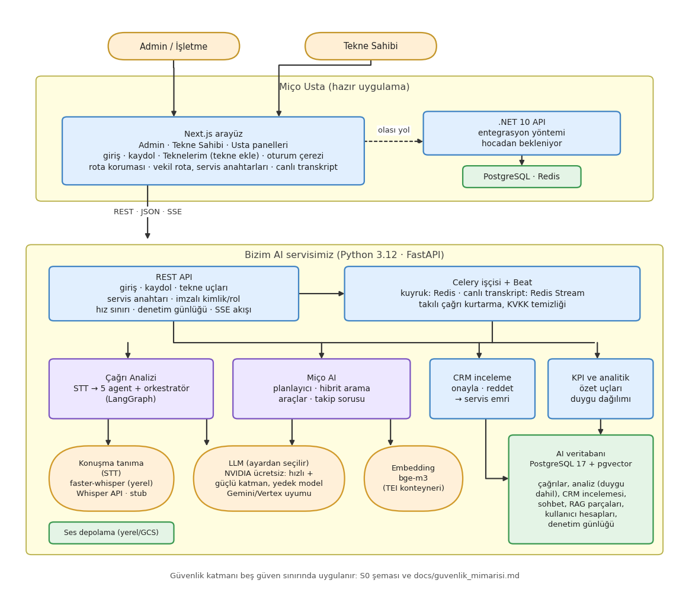
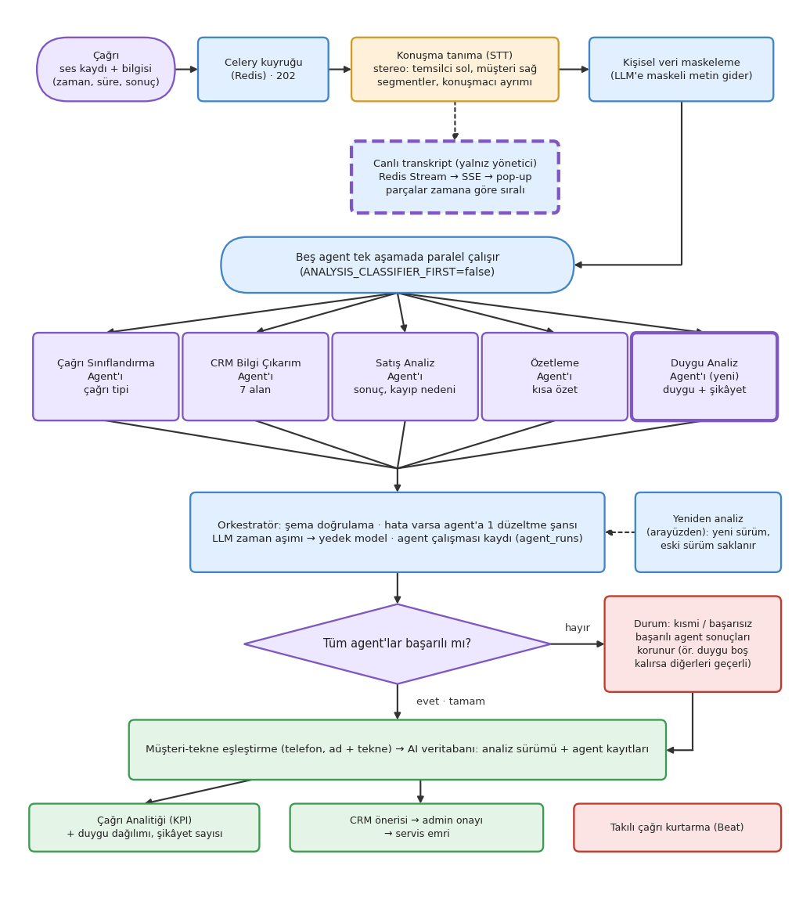
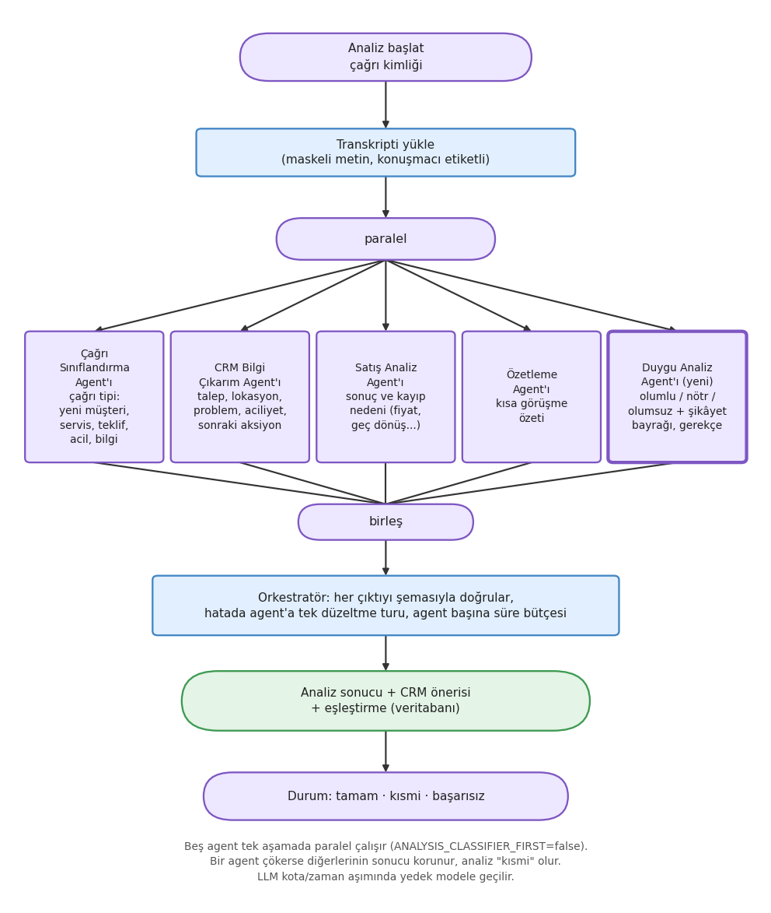
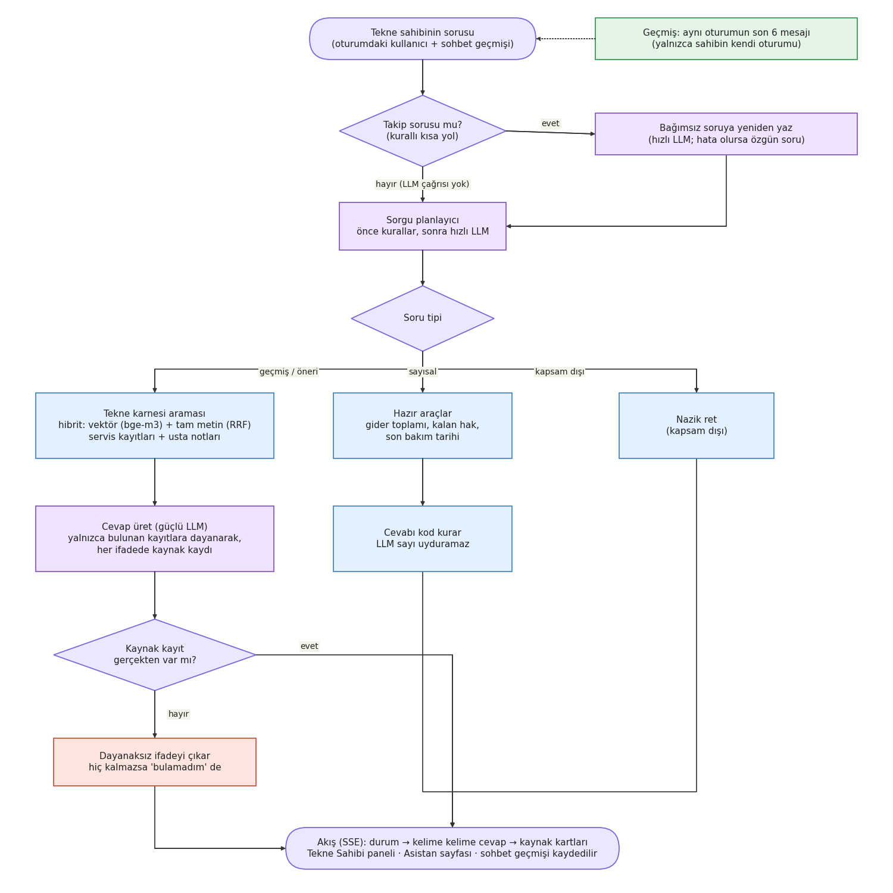
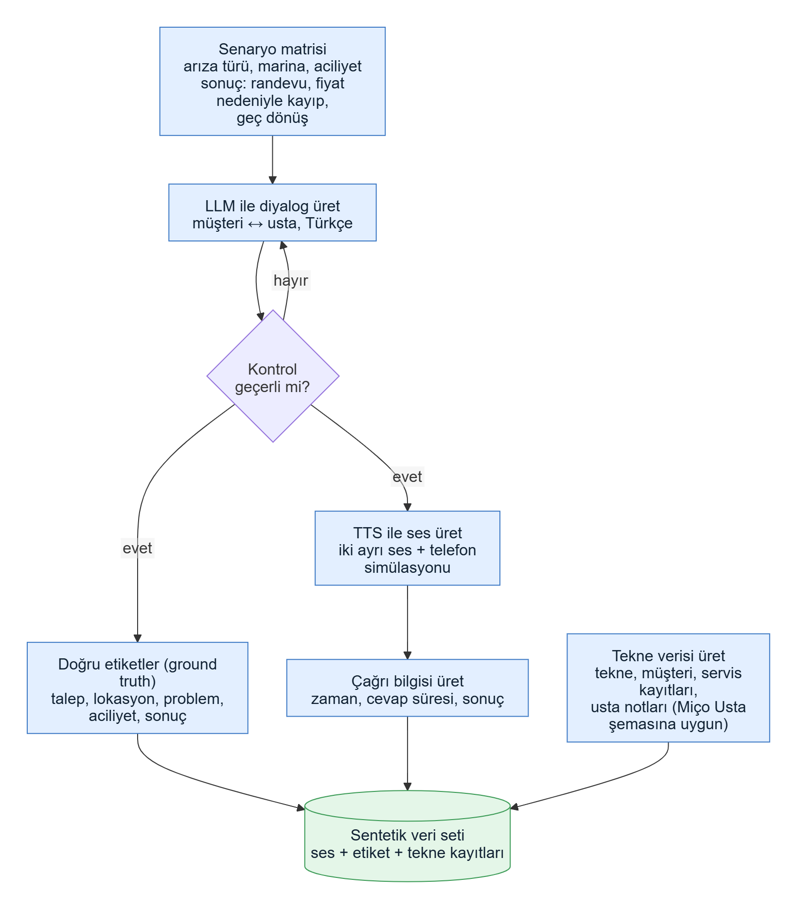
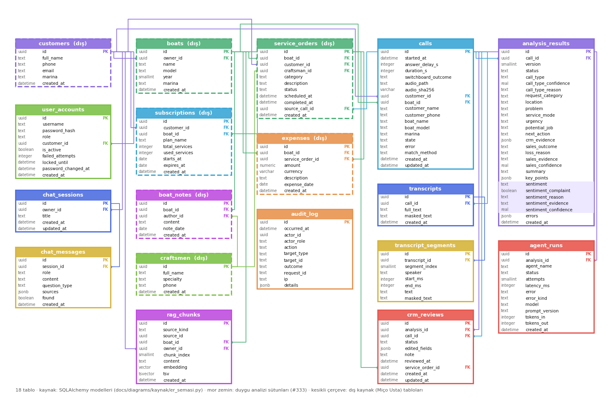
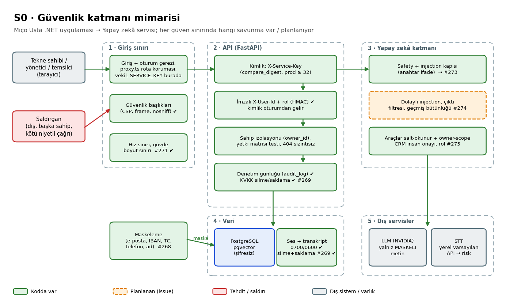

# Miço Usta Çağrı Analitiği ve Miço AI

🇹🇷 Türkçe · [🇬🇧 English](README.en.md)

İstanbul Gedik Üniversitesi, MFK420 Mezuniyet Projesi. Telefon görüşmelerini otomatik analiz eden, tekne bakım ve servis firması **Miço Usta** için tasarlanmış, yapay zekâ destekli çağrı analitiği ve tekne sahibi asistanı sistemi.

**Ekip:** Berkay Öztürk (yapay zekâ, agent'lar, RAG) · Ahmet Aydın (frontend) · Melih Uyanık (backend, veri)

> Tüm veri **sentetiktir**; gerçek müşteri verisi yoktur. LLM'e giden metin kişisel veriden arındırılır.

## İçindekiler

- [Ne yapar?](#ne-yapar)
- [Mimari](#mimari)
- [Teknolojiler](#teknolojiler)
- [Hızlı başlangıç](#hızlı-başlangıç)
- [Yapılandırma](#yapılandırma)
- [Proje yapısı](#proje-yapısı)
- [Test ve kalite](#test-ve-kalite)
- [Başarı kriterleri](#başarı-kriterleri)
- [Ölçülen sonuçlar](#ölçülen-sonuçlar)
- [Güvenlik ve gizlilik](#güvenlik-ve-gizlilik)
- [Katkı süreci](#katkı-süreci)
- [Yol haritası](#yol-haritası)
- [Belgeler](#belgeler)

## Ne yapar?

| # | Özellik | Kullanıcı | Kısaca |
|---|---|---|---|
| 1 | **Çağrıdan CRM kaydı** | Admin | Ses veya metin yüklenir; konuşma yazıya çevrilir, 5 agent 7 CRM alanını, müşteri duygusunu ve şikâyet bayrağını çıkarır. Yönetici öneriyi onaylar, düzenleyerek onaylar veya reddeder; ilk onayda servis emri açılır. |
| 2 | **Çağrı Analitiği** | Admin | Çağrı sayısı, acil, satışa dönüşen ve kaybedilen çağrılar, en sık arıza, en yoğun marina, satış kaybı nedenleri; tarih ve marina filtresi. |
| 3 | **Miço AI** | Tekne sahibi | Sahibin kendi tekne karnesi, işleri, giderleri ve aboneliği üzerinden **kaynak göstererek** cevap veren sohbet asistanı. Sayıları kod hesaplar, model uydurmaz. |
| 4 | **Duygu analizi** (5. agent) | Admin | Müşterinin genel duygusu (olumlu / nötr / olumsuz), açık şikâyet bayrağı, kısa gerekçe ve konuşmadan alıntı. Çağrı listesinde ve detayında rozet, analitikte dağılım ve şikâyetli çağrı sayısı. |
| 5 | **Canlı transkript** | Admin | Çağrı yüklenip yazıya çevrilirken konuşma, temsilci solda ve müşteri sağda olmak üzere pop-up'ta canlı akar (Redis Stream + SSE). |

**Öne çıkan özellikler**

- Beş agent paralel çalışır (çağrı sınıflandırma, CRM çıkarımı, satış analizi, özetleme, duygu analizi); her çıktı şemayla doğrulanır, hata olursa bir düzeltme turu verilir, biri çökerse diğerlerinin sonucu korunur (kayıt "kısmi" tamamlanır).
- Stereo santral kaydında her kanal ayrı yazıya çevrilir (temsilci sol, müşteri sağ); konuşmacılar ayrılır. Mono kayıtta konuşmacı ayrımı metin tabanlıdır (dil modeliyle).
- Yazıya çevirme sürerken canlı transkript pop-up'ı açılır; akış yalnız yönetici içindir, hata olursa analiz etkilenmez.
- Çağrı otomatik olarak telefon veya ad + tekne adıyla kayıtlı müşteri ve tekneye bağlanır; bağlanmazsa yönetici elle eşleştirir.
- Analiz sürümlüdür: yeniden analiz yeni sürüm üretir, eskiler saklanır; onay analiz sürümüne bağlıdır.
- Dayanıklılık: LLM zaman aşımında yedek modele geçilir; takılı kalan çağrı otomatik kurtarılır.
- Miço AI: hibrit arama (vektör + tam metin, RRF), takip soruları, kelime kelime akış (SSE), oturum geçmişi, dayanaksız ifadeyi eleyen kaynak denetimi.
- Miço AI güvenlik katmanı (LLM'siz): küfür, tehdit, kendine zarar, kural aşma girişimi, başkasının verisini isteme ve anlamsız metin için ayrı, duruma göre değişen cevaplar.
- Tekne sahibi yalnızca **kendi** verisini görür; oturum geçmişi de yalnızca kendi oturumundan okunur.

## Mimari



Kullanıcılar (admin ve tekne sahibi) Next.js arayüzünü kullanır. Arayüz, sunucu tarafı bir proxy ve servis anahtarıyla Python AI servisini (FastAPI) çağırır. Uzun işler (ses → yazı, analiz, indeksleme) Celery işçisinde çalışır; kuyruk Redis'tir; canlı transkript parçaları Redis Stream'inden SSE ile arayüze akar. Servis; konuşma tanıma (STT), LLM ve embedding hizmetlerini kullanır, sonuçları PostgreSQL'e (pgvector) yazar.

| Diyagram | İçerik |
|---|---|
|  | Çağrı analizi akışı: ses → yazı → agent'lar → CRM ve KPI |
|  | Agent'lar ve LangGraph orkestratörü |
|  | Miço AI akışı: planlama, arama, kaynak denetimi |
|  | Sentetik çağrı ve tekne verisi üretimi |
|  | Veritabanı ER diyagramı (18 tablo) |
|  | Güvenlik katmanı mimarisi; beş perspektifin şemaları ve ayrıntısı: [`docs/guvenlik_mimarisi.md`](docs/guvenlik_mimarisi.md) |

Ayrıntılı mimari, kararlar ve mevcut durum: [`Sistem_mimarisi_v6.1.md`](Sistem_mimarisi_v6.1.md).

## Teknolojiler

| Katman | Teknoloji |
|---|---|
| Backend | Python 3.12, FastAPI 0.162, Pydantic 2.14, SQLAlchemy 2.1 (async) + asyncpg, Alembic 1.20 |
| Arka plan işleri | Celery 5.7 + Redis (Beat ile periyodik görevler; canlı transkript için Redis Stream) |
| Veritabanı | PostgreSQL 17 + pgvector (18 tablo, Alembic 0008) |
| Agent'lar | LangGraph 1.2 + LangChain 1.5 (5 agent); LLM sağlayıcısı ayardan seçilir (geliştirmede NVIDIA Nemotron: hızlı + güçlü + yedek model) |
| Konuşma tanıma | faster-whisper 1.2 (yerel, CPU; `large-v3-turbo` varsayılan, bellek kısıtlıysa `small`); Whisper API ve stub yedek |
| Embedding | bge-m3 (TEI konteyneri), 1024 boyut |
| Frontend | Next.js 16.4, React 19.3, TypeScript 5, Tailwind CSS 4 |
| Test | pytest (~2.460 test), Playwright 1.65 (e2e + erişilebilirlik/axe), ruff, mypy, ESLint |
| Altyapı | Docker Compose, GitHub Actions |

## Hızlı başlangıç

Ayrıntılı rehber ve sorun giderme: [`docs/calistirma.md`](docs/calistirma.md).

### A) Tüm sistem Docker'da (tek komut)

Makinede Python veya Node kurulu olması gerekmez. Docker Desktop yeterlidir.

```bash
# Repo kök dizininde
docker compose -f infra/docker-compose.yml --profile app up -d
```

Sırasıyla PostgreSQL ve Redis başlar, `init` servisi migration'ları uygular ve veritabanı boşsa 100 çağrılık sentetik veriyi yükler, ardından API (`:8000`), Celery işçisi ve web arayüzü (`:3000`) açılır. Miço AI için embedding servisini de eklemek isterseniz `--profile app --profile rag` verin.

### B) Geliştirme ortamı (2 terminal)

Gerekenler: Docker Desktop, [uv](https://docs.astral.sh/uv/), Node.js 20+ (CI'da 22).

```bash
# İlk kurulum (bir kez)
cd backend
uv sync --extra ai --extra stt
cp .env.example .env          # Windows PowerShell: Copy-Item .env.example .env
cd ../frontend
npm install
cp .env.example .env.local    # Windows PowerShell: Copy-Item .env.example .env.local
```

`backend/.env` içinde en az `SERVICE_API_KEY` ve `LLM_API_KEY` doldurulur; `frontend/.env.local` içindeki `SERVICE_KEY`, backend'deki `SERVICE_API_KEY` ile aynı olmalıdır.

```bash
# Terminal 1: backend (altyapı, migration, seed, indeks, işçi ve API'yi tek komutla başlatır)
cd backend
uv run python -m scripts.dev

# Terminal 2: frontend  →  http://localhost:3000
cd frontend
npm run dev
```

İlk çalıştırma birkaç dakika sürebilir (embedding modeli ~2,3 GB iner); sonraki açılışlar birkaç saniyedir.

> **Windows notu:** `REDIS_URL` için `localhost` yerine `127.0.0.1` kullanın (`.env.example`'daki varsayılan budur). `localhost` önce IPv6'ya gittiği için her Redis bağlantısı ~2 sn gecikir.

## Yapılandırma

Tüm ayarlar `backend/.env` dosyasından okunur (`backend/.env.example` açıklamalıdır). Sık kullanılanlar:

| Değişken | Anlamı |
|---|---|
| `SERVICE_API_KEY` | Arayüz ile AI servisi arasındaki servis anahtarı (gizli, repoya girmez) |
| `LLM_PROVIDER`, `LLM_API_KEY`, `LLM_FAST_MODEL`, `LLM_SMART_MODEL`, `LLM_FALLBACK_MODEL` | LLM sağlayıcısı, anahtar ve modeller |
| `STT_PROVIDER`, `WHISPER_MODEL`, `STT_CHANNEL_LAYOUT`, `WHISPER_INITIAL_PROMPT` | Konuşma tanıma: sağlayıcı, model boyutu, kanal düzeni, alan sözcükleri |
| `EMBEDDING_PROVIDER`, `TEI_URL` | Embedding servisi |
| `AUDIO_STORAGE_BACKEND` | Ses depolama: `local` veya `gcs` |
| `ANALYSIS_CLASSIFIER_FIRST` | `true` ise eski "önce sınıflandırma" sırası |
| `LLM_SENTIMENT_ANALYZER_MODEL` | Duygu analizi agent'ının modeli (boşsa güçlü model) |

Gizli anahtarlar koda veya repoya eklenmez.

## Proje yapısı

```
backend/    FastAPI uygulaması (app/), Celery işçisi, Alembic migration'ları, betikler (scripts/), testler (tests/)
frontend/   Next.js uygulaması: admin (analitik, çağrılar, CRM, servis emirleri) ve tekne sahibi (asistan) panelleri, Playwright testleri (e2e/)
infra/      docker-compose.yml (altyapı + uygulama profilleri), duman testi bindirmesi
data/       Sentetik çağrı transkriptleri, doğru etiketler (truth/), tekne verisi
docs/       API sözleşmesi, şema, ölçüm raporları, çalıştırma ve canlıya alma rehberleri, diyagramlar
```

## Test ve kalite

```bash
cd backend
uv run ruff check . && uv run ruff format --check .
uv run mypy app
uv run pytest                      # ~2.460 test

cd ../frontend
npm run lint && npm run build
npm run e2e                        # Playwright (önce: npx playwright install)
```

**CI (GitHub Actions):** Backend: değişiklik tespiti, ruff, mypy, pytest, bağımlılık sürümü uyumu, Docker imajı, güvenlik taraması (pip-audit; açık bulguda kırılır), gizli anahtar taraması (gitleaks, ayrı iş akışı), haftalık Trivy imaj raporu, Dependabot, Docker Compose ile uçtan uca duman testi (API + Celery + DB + Redis), belge tutarlılığı. Frontend: ESLint + build, Playwright e2e (Chromium), Docker imajı. `main` dalı ruleset ile korunur; `Backend CI sonucu` ve `Frontend CI sonucu` kontrolleri zorunludur.

## Başarı kriterleri

Proje başında belirlediğimiz hedefler ve 20 Kasım 2026 itibarıyla ölçülen durum:

| # | Kriter | Nasıl ölçülür | Hedef | Şu anki durum |
|---|---|---|---|---|
| 1 | STT doğruluğu | Telefon sesi simüleli sentetik test setinde WER | WER ≤ %15 | ⚠️ `medium` **%15,4** (hedefe çok yakın), varsayılan `small` %24,8. Hedef için `medium` gerekir; bellek ve süre dengesi sürüyor ([`docs/stt_karari.md`](docs/stt_karari.md)) |
| 2 | Şikayet tespiti | Etiketli sentetik çağrılarda karşılaştırma | Recall ≥ %90, Precision ≥ %80 | ✅ 119 çağrıda (100 ana + 19 ek) Recall **%100** (11/11), Precision **%92** (11/12). Örnek sayısı az, etiketler tek kişiden; istem ilk ölçümdeki hatalardan ayarlandı (ilk ölçümde Precision %61) ([`docs/agent_dogrulugu.md`](docs/agent_dogrulugu.md)) |
| 3 | Konu ve niyet sınıflandırma | Aynı test setinde doğruluk; duygu için makro F1 | Doğruluk ≥ %80, F1 ≥ 0,70 | ✅ Doğruluk: test kümesinde genel **%94**, çağrı tipi %85, talep kategorisi %95 ([`docs/agent_dogrulugu.md`](docs/agent_dogrulugu.md)). Duygu makro F1 ≈ **0,95** (olumlu 1,00 · nötr 0,98 · olumsuz 0,88; 119 çağrı, duygu doğruluğu %97; olumlu yalnız 8, olumsuz 13 örnek) |
| 4 | Sayısal soru doğruluğu | 20 sayısal soru: sohbet = SQL sonucu = dashboard | %100 tutarlı | ✅ **20/20** sohbet cevabı = SQL sonucu ([`docs/dayaniklilik.md`](docs/dayaniklilik.md)) |
| 5 | Uçtan uca süre | 5 dakikalık çağrı: yüklemeden analiz sonucuna | ≤ 3 dakika | ⚠️ Tahmini 1,5–2 dk (STT 60–90 sn + analiz ~10 sn), ancak bu makinede `small` ile ölçülemedi; manuel testte yazıya çevirme 2–3 dk görüldü, **yeniden ölçülecek** |
| 6 | Güvenilirlik | 30 test çağrısının işlenmesi | ≥ %95 hatasız tamamlanma | ✅ **55/55** geçerli çağrı hatasız (%100), 40 çağrılık toplu koşu dahil |

Durum: ✅ karşılandı · ⚠️ kısmen / sınırda · ⏳ ölçülmedi.

## Ölçülen sonuçlar

Sentetik veri üzerinde, gerçek LLM ile (ayrıntılar `docs/` altında):

| Ölçüm | Sonuç | Kaynak |
|---|---|---|
| CRM alan doğruluğu (100 çağrı: 60 geliştirme, 40 dokunulmaz test) | Test kümesinde genel **%94**; sonraki aksiyon **%92** | [`docs/agent_dogrulugu.md`](docs/agent_dogrulugu.md) |
| Konuşma tanıma (telefon sesi, stereo) | WER `small` %24,8, `medium` **%15,4** | [`docs/stt_karari.md`](docs/stt_karari.md) |
| Toplu analiz güvenilirliği | **55/55** geçerli çağrı hatasız | [`docs/dayaniklilik.md`](docs/dayaniklilik.md) |
| Miço AI sohbet kalitesi (82 soru) | **%95-98** uygun cevap | [`docs/asistan_sohbet_olcumu.md`](docs/asistan_sohbet_olcumu.md) |
| Yük (tek süreç, 30 eşzamanlı) | Hatasız; liste ~52 istek/sn | [`docs/guvenlik_yuk.md`](docs/guvenlik_yuk.md) |
| Duygu analizi (119 çağrı) | Duygu doğruluğu **%97** (116/119), şikâyet duyarlılığı %100, kesinliği %92 | [`docs/agent_dogrulugu.md`](docs/agent_dogrulugu.md) |
| Analiz süresi | Beş agent paralel; LLM aşaması ~5 sn; duygu agent'ı eklenince 10 çağrıda ortalama +0,5 sn (ölçüm gürültüsü düzeyinde) | [`docs/analiz_sureleri.md`](docs/analiz_sureleri.md), [`docs/agent_dogrulugu.md`](docs/agent_dogrulugu.md) |

## Güvenlik ve gizlilik

- Veri tamamen sentetiktir; kişisel veriler LLM'e gitmeden maskelenir.
- Arayüz AI servisini servis anahtarıyla çağırır; tekne sahibinin kimliği isteğe eklenir. Yetki matrisi testleriyle başka sahibin verisine erişilemediği doğrulanır.
- Miço AI cevabındaki her iddia bir kayda dayanır; dayanaksız ifade silinir.
- Miço AI küfür, tehdit, kendine zarar, kural aşma ve başkasının verisi isteklerini LLM'e göndermeden cevaplar.
- Güvenlik katmanı beş güven sınırında uygulanır: imzalı kimlik ve roller, hız sınırı ve güvenlik başlıkları, maskeleme, çok katmanlı (doğrudan ve dolaylı) prompt injection savunması, denetim günlüğü, KVKK silme ve saklama, ses dosyası doğrulaması. Saldırı test paketi: [`docs/guvenlik_testi.md`](docs/guvenlik_testi.md); ayrıntı: [`docs/guvenlik_mimarisi.md`](docs/guvenlik_mimarisi.md).
- Canlı transkript akışı yalnız yönetici içindir (ham metin): çağrı başına en çok 5 izleyici, süre ve olay sınırı vardır.

## Katkı süreci

`main`'e doğrudan commit yoktur. Her iş ayrı bir dalda yapılır, PR açılır, CI yeşil olmalı ve PR onaylanmalıdır. Commit ve PR açıklamaları Türkçe yazılır; kod ve veritabanı İngilizce, arayüz ve LLM çıktısı Türkçedir.

## Yol haritası

| Durum | İş |
|---|---|
| Hazır | Çağrı analizi (5 agent), CRM onay akışı, servis emirleri, KPI ekranları, Miço AI, canlı transkript, duygu analizi, güvenlik katmanı, Docker ile tek komut, CI |
| Manuel test bekliyor | Canlı transkript ve duygu analizi (sorun çıkarsa düzeltme issue'ları açılır) |
| Planlı | Yazıya çevirme doğruluğu ve ücretsiz STT modellerinin karşılaştırması; embedding alternatifleri (4 model, reranker, Hugging Face API) karşılaştırması; arka planda otomatik güvenlik turu |
| Final | Miço Usta uygulamasına entegrasyon ve Google Cloud'a canlıya alma ([`docs/canliya_alma.md`](docs/canliya_alma.md)); giriş ekranı kararı hocayla |

## Belgeler

| Belge | İçerik |
|---|---|
| [`Sistem_mimarisi_v6.1.md`](Sistem_mimarisi_v6.1.md) | Mimari, kararlar, güvenlik katmanı, mevcut durum (v6.1) |
| [`docs/db_schema.md`](docs/db_schema.md) | Veritabanı şeması ve ER diyagramı |
| [`docs/api.md`](docs/api.md) | API sözleşmesi |
| [`docs/enums.md`](docs/enums.md) | Alan değer listeleri |
| [`docs/agent_dogrulugu.md`](docs/agent_dogrulugu.md) | Yapay zekâ doğruluk ölçümü (duygu analizi dahil) |
| [`docs/stt_karari.md`](docs/stt_karari.md) | Konuşma tanıma kararı ve ölçümü |
| [`docs/asistan_sohbet_olcumu.md`](docs/asistan_sohbet_olcumu.md) | Miço AI sohbet kalitesi ve güvenlik ölçümü |
| [`docs/analiz_sureleri.md`](docs/analiz_sureleri.md) | Analiz süresi, aşama aşama |
| [`docs/dayaniklilik.md`](docs/dayaniklilik.md), [`docs/guvenlik_yuk.md`](docs/guvenlik_yuk.md) | Dayanıklılık, yük ve güvenlik ölçümleri |
| [`docs/guvenlik_mimarisi.md`](docs/guvenlik_mimarisi.md), [`docs/guvenlik_testi.md`](docs/guvenlik_testi.md), [`docs/kisisel_veri_envanteri.md`](docs/kisisel_veri_envanteri.md) | Güvenlik katmanı, saldırı testleri, kişisel veri envanteri |
| [`docs/calistirma.md`](docs/calistirma.md) | Çalıştırma rehberi ve sorun giderme |
| [`docs/canliya_alma.md`](docs/canliya_alma.md) | Canlıya alma rehberi |
| [`docs/ekip_test_senaryosu.md`](docs/ekip_test_senaryosu.md) | Ekip içi test senaryosu (Miço AI örnek soruları: [`docs/test_senaryosu.md`](docs/test_senaryosu.md)) |
