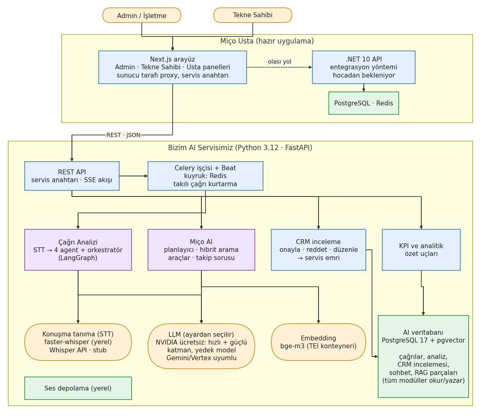
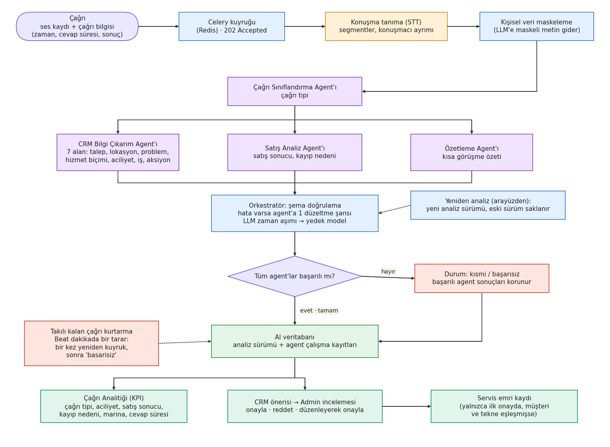
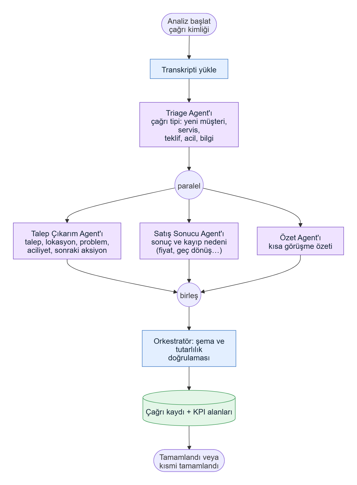
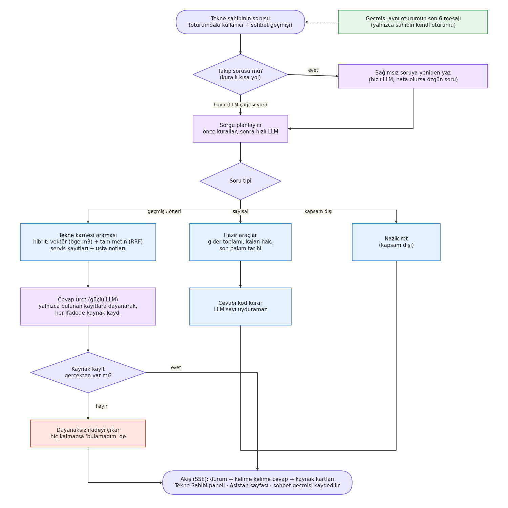
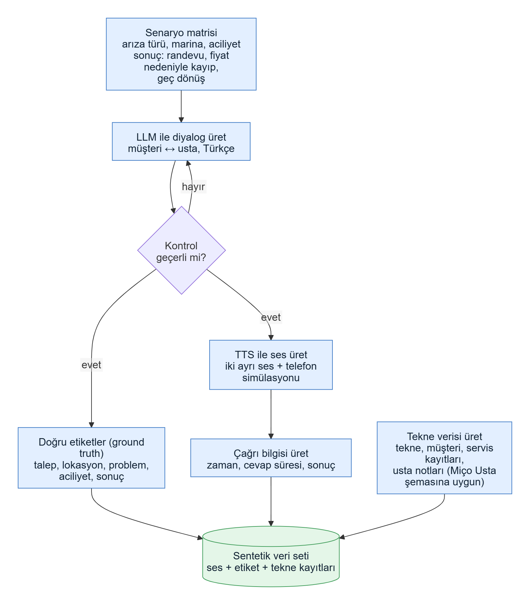

# Sistem Mimarisi v4

**Proje:** Yapay Zekâ Destekli Sesli Asistan ve Çağrı Merkezi Analitiği Sistemi
**Sürüm:** v4 · **Tarih:** 2026-10-17 · **Durum:** Güncel · **Önceki sürümler:** v1, v2, v3.0, v3.1 (git geçmişinde)

**v4'te değişenler:** v3.1'den bu yana sistem çalışır hale geldi; bu sürüm belgeyi gerçek duruma getirir. Çağrı analizi, CRM onay akışı, KPI ekranları ve Miço AI sohbeti gerçek veriyle uçtan uca çalışıyor. Seçilen teknolojiler (LLM, STT, embedding), takılı çağrı kurtarma, LLM yedek modeli ve çok turlu sohbet bağlamı eklendi. Diyagramlar yenilendi. Ayrıntılar §13'te.

---

## 1. Amaç ve Kapsam

- Miço Usta uygulamasına üç iş ekliyoruz (hocanın senaryo numaralarıyla 1, 5 ve 2):
  1. **Çağrı → CRM kaydı (Admin paneli):** Müşteriyle yapılan telefon görüşmesi otomatik analiz edilir; talep, lokasyon, problem, aciliyet ve sonraki aksiyon çıkarılıp CRM kaydı önerilir. Admin öneriyi **onaylar, reddeder veya düzenleyerek onaylar**; onayda servis emri oluşur.
  2. **Çağrı Analitiği (Admin paneli):** Aylık KPI'lar ve "satış neden kaçtı" analizi.
  3. **Miço AI (Tekne Sahibi paneli):** Tekne sahibinin kişisel asistanı; tekne karnesi, işler, giderler ve abonelik verisinden cevap verir, takip sorularını anlar.
- **Kapsam dışı:** Usta paneli, canlı (gerçek zamanlı) çağrı akışı, telefon santrali entegrasyonu, model eğitimi.
- **Terimler:** *Agent* = yapay zekâ bileşeni. *Usta* = tekne teknisyeni.

## 2. Takvim

| Tarih | Olay |
|-------|------|
| 12–18 Ekim (5. hafta) | Eksik parçalar tamamlandı: CRM onay akışı, yeniden analiz, takılı çağrı kurtarma, LLM dayanıklılığı, çok turlu sohbet |
| 19–25 Ekim (6. hafta) | Vize demosunu işlevsel olarak tamamlama (CRM onay arayüzü, servis emirleri, çağrı yükleme akışı, doğruluk ve veri) |
| 16 Kasım 23:59 | Vize sunumu yükleme (sunum: 17–19 Kasım) |
| 14 Aralık | Final sunumu yükleme (sunum: 15–17 Aralık); **canlıya alma final zamanı** |
| 28 Aralık | Demo ve tez son teslim |
| 5 Ocak | Demo ve poster sunumu |

**Vize hedefi:** Admin panelinde çağrı analizi ve CRM kaydı çalışır durumda (iş 1 ve 2); Miço AI de gösterilebilir durumda. **Vizeden sonra:** Google Cloud'a canlıya alma, ölçümler, ince ayar.

## 3. Temel Kararlar

- **Hazır uygulamaya entegrasyon.** Miço Usta (Next.js arayüz, .NET 10 backend, PostgreSQL, Redis, Google Cloud) olduğu gibi kalır; biz ona yeni sayfalar ekleriz.
- **AI servisimiz ayrı bir Python servisi (FastAPI) olarak çalışır** ve REST (JSON) üzerinden konuşur. Bugün arayüz, sunucu tarafı bir proxy ve servis anahtarıyla doğrudan bizim servisimizi çağırıyor; .NET API ile entegrasyon yöntemi hocadan bekleniyor. *(Hocaya soruldu.)*
- **Orkestratör LangGraph ile kurulu.** Önce Çağrı Sınıflandırma, sonra diğer üç agent paralel çalışır. Yeni agent eklemek akışı değiştirmez.
- **LLM sağlayıcısı ayardan seçilir.** Geliştirmede NVIDIA'nın ücretsiz modelleri (hızlı ve güçlü katman) kullanılıyor; Gemini/Vertex AI uyumluluğu korunuyor. Geçici hatada (zaman aşımı, kota, sunucu hatası) bir kez **yedek modele** geçilir; istek ve agent süreleri sınırlıdır.
- **Yapılandırılmış çıktı:** Her agent şemaya uygun JSON döner; çıktı doğrulanmadan kayda yazılmaz.
- **Veritabanı:** Standart PostgreSQL + pgvector; şema **Alembic** migration'larıyla kurulur (Supabase Auth ve RLS'e bağımlılık yok). Geliştirmede Docker ile yerel PostgreSQL 17 çalışır; canlıda büyük ihtimalle kendi PostgreSQL'imiz. *(Hocaya sorulacak.)*
- **Veri tamamen sentetiktir** (gerçek müşteri verisi yok, KVKK). LLM'e giden metin kişisel veriden arındırılır.
- **Tekne sahibi yalnızca kendi teknesinin verisini görür.** Asistan, oturumdaki kullanıcının yetkisiyle çalışır; sohbet geçmişi de yalnızca sahibin kendi oturumundan okunur.
- **Cevaplar kaynaklıdır.** Miço AI cevabındaki her iddia bir kayda dayanır; sayılar kodla hesaplanır, LLM sayı uydurmaz.
- **Kod ve veritabanı İngilizce, arayüz ve LLM çıktısı Türkçe.**
- **Süreç:** main'e doğrudan commit yok; her iş ayrı branch + PR, CI yeşil ve onaylı.

## 4. Genel Mimari

Kullanıcılar (admin ve tekne sahibi) Miço Usta'nın Next.js arayüzünü kullanır. Arayüz, REST ile bizim AI servisimizi çağırır. AI servisi; çağrı analizi, Miço AI, CRM inceleme ve KPI modüllerinden oluşur. Uzun işler (ses → yazı, analiz, indeksleme) Celery işçisinde çalışır; kuyruk Redis'tir. Servis, konuşma tanıma (STT), LLM ve embedding hizmetlerini kullanır; sonuçları kendi veritabanına yazar. Miço AI, tekne karnesi verisini bu veritabanından okur.

Not: Gezdiğimiz örnek site (Figma Make ile hazırlanmış bir prototip) arayüzün görünümünü gösteriyor. Gerçek uygulamanın kod tabanı ve veri şeması hocadan alınacaktır.

## 5. Teknoloji

| Katman | Miço Usta (hazır) | Bizim AI servisimiz |
|--------|-------------------|---------------------|
| Backend | .NET 10 | Python 3.12 + FastAPI |
| Arayüz | Next.js | Next.js 16 (Ahmet, hazır uygulamaya sayfa ekler), Tailwind |
| Veritabanı | PostgreSQL | PostgreSQL 17 + pgvector; migration'lar Alembic |
| Kuyruk / önbellek | Redis | Celery + Redis; Beat ile periyodik görevler |
| Bulut | Google Cloud | Google Cloud'da canlıya alma (final) |
| LLM | Vertex AI / Gemini | Sağlayıcı arayüzü; geliştirmede NVIDIA ücretsiz modelleri, yedek model |
| Konuşma tanıma | — | faster-whisper (yerel), Whisper API, stub; sağlayıcı kararı #124'te |
| Embedding | — | bge-m3, TEI konteynerinde (Docker) |
| Ses üretimi (seed) | — | Piper (çevrimdışı Türkçe) |
| Agent orkestrasyonu | — | LangGraph + LangChain |
| Geliştirme | — | uv, ruff, mypy, pytest; GitHub Actions CI (duman testi dahil) |

Kilit dosyaları (`uv.lock`, `package-lock.json`) repoda tutulur; `requirements.txt` `uv.lock`'tan üretilir.

## 6. Pipeline'lar

### 6.1 Çağrı Analitiği (Admin paneli, iş 1 ve 2)

- Girdi: çağrının **ses kaydı** (veya metni) ve **çağrı bilgisi** (çağrı zamanı, cevap süresi, sonuç).
- Ses metne çevrilir, konuşmacılar müşteri ve usta olarak ayrılır, kişisel veriler maskelenir.
- Agent'lar konuşmadan CRM alanlarını çıkarır. Çıktı doğrulanır; doğrulanmazsa agent'a bir kez düzeltme şansı verilir.
- Sonuç iki yere gider: **CRM** (müşteri ve servis emri önerisi) ve **Çağrı Analitiği** (KPI).
- **CRM onayı:** Admin öneriyi onaylar, reddeder veya alanları düzenleyerek onaylar. Servis emri yalnızca ilk onayda ve çağrının müşteri ile teknesi eşleşmişse oluşur. Onay analiz sürümüne bağlıdır; çağrı yeniden analiz edilirse yeni sürüm yeniden "bekliyor" olur.
- **Yeniden analiz:** Arayüzdeki düğmeyle çağrı için yeni bir analiz sürümü üretilir; eski sürümler saklanır.
- **Dayanıklılık:** Çağrı durumları: beklemede, yazıya çevriliyor, işleniyor, tamam, kısmi, başarısız. İşçi ölür veya görev takılırsa Beat dakikada bir tarar; takılı çağrı bir kez yeniden kuyruğa alınır, ikinci kez takılırsa "başarısız" olur ve yeniden analiz düğmesi devreye girir. LLM zaman aşımında yedek modele geçilir. Bir agent çökerse diğerlerinin sonucu korunur ve kayıt "kısmi" tamamlanır.
- Hocanın örneği: "Motor çalışıyor ama gaz verdiğimde devir yükselmiyor, Tuzla Marina'da, yarın usta gelebilir mi?" → müşteri talebi: motor arızası, lokasyon: Tuzla Marina, problem: motor devir almıyor, talep: yerinde servis, aciliyet: yüksek, potansiyel iş: motor arıza tespiti, sonraki aksiyon: servis randevusu oluştur.

- **Çağrı Sınıflandırma Agent'ı:** çağrı tipi (yeni müşteri, servis, teklif, acil, bilgi).
- **CRM Bilgi Çıkarım Agent'ı:** CRM kaydının 7 alanı: müşteri talebi, lokasyon, problem, hizmet biçimi, aciliyet, potansiyel iş, sonraki aksiyon.
- **Satış Analiz Agent'ı:** satış sonucu ve kayıp nedeni (fiyat, geç dönüş).
- **Özetleme Agent'ı:** kısa görüşme özeti.
- **Orkestratör:** agent'ları çalıştırır, her çıktıyı şemasıyla yeniden doğrular ve sonucu yazar. Doğrulama hatasında agent'a bir kez düzeltme şansı verir; her agent için toplam süre bütçesi vardır. Her agent çalışması (süre, deneme sayısı, kullanılan model, yedek modele geçip geçmediği, hata) kaydedilir.
- **Ölçülen doğruluk (sentetik veri, 30 çağrı):** genel yaklaşık %88; aciliyet ve problem alanları yaklaşık %70, sonraki aksiyon yaklaşık %77. Hedef ≥ %85 (6. hafta, dokunulmaz test setiyle).

**KPI'ların kaynağı**

| KPI | Nereden gelir |
|-----|---------------|
| Gelen çağrı | Çağrı sayısı |
| Yeni müşteri, servis talebi, teklif talebi, acil servis | Konuşmadan çıkarılan çağrı tipi ve aciliyet |
| Satışa dönüşen, kaybedilme nedeni | Satış Analiz Agent'ı |
| En sık arıza, en yoğun marina | Konuşmadan çıkarılan problem ve lokasyon |
| Ortalama cevap süresi | Ses dosyasından çıkmaz; **çağrı bilgisinden** (çalma ve açılma zamanı) hesaplanır |

KPI'lar İstanbul saatine göre günlere ayrılır.

### 6.2 Miço AI (Tekne Sahibi paneli, iş 3)

- Soru önce **takip sorusu mu** diye bakılır ("Peki ne yapılmıştı?", "Bu ayki?"). Öyleyse oturumun son mesajlarına bakılarak bağımsız bir soruya çevrilir; bağımsız sorularda ek LLM çağrısı yapılmaz, gecikme eklenmez.
- Soru planlanır: geçmiş/öneri, sayısal, kapsam dışı. Önce kurallar, kurallar yakalamazsa hızlı LLM.
- Geçmiş ve öneri soruları tekne karnesi ve ustaların notları üzerinde aranır (vektör + tam metin birleşik arama, RRF). Örnek: "Son bakım ne zaman yapıldı?", "Yakında yapılması gereken bir şey var mı?".
- Sayısal sorular (gider toplamı, kalan paket hakkı, son bakım tarihi) hazır araçlarla hesaplanır ve cümleyi kod kurar.
- Cevapta hangi kayda dayandığı kaynak kartı olarak gösterilir; dayanaksız ifade çıkarılır, kayıt yoksa "bulamadım" denir.
- Cevap kelime kelime akar (SSE); sohbetler oturum olarak saklanır ve arayüzde geçmişi görülür.
- Yetki: Yalnızca oturumdaki tekne sahibinin teknelerine ait veri ve kendi oturumunun geçmişi kullanılır.
- Opsiyonel: Admin panelindeki mevcut "AI Asistan" sohbet kutusu aynı altyapıyla iyileştirilebilir (hocanın listesinde yok).

### 6.3 Sentetik Veri

- **Çağrı verisi:** Senaryo matrisinden (arıza türü, marina, aciliyet, sonuç) LLM ile Türkçe müşteri-usta diyalogları üretilir, doğru etiketler ve çağrı bilgisi (zaman, cevap süresi, sonuç) ayrıca kaydedilir. Seed çağrılarının sesi Piper ile üretilir.
- **Tekne verisi:** Miço Usta şemasına uygun tekne, müşteri, servis kaydı, gider, abonelik ve usta notları üretilir (Miço AI'nin cevap kaynağı).
- Doğru etiketler baştan bilindiği için sistemin doğruluğu otomatik ölçülür (`scripts.evaluate`).
- Bugün 30 çağrı var. Hedef: 90 çağrıya çıkarmak (içinde dokunulmaz test seti ve sesler); finale doğru yaklaşık 150.

## 7. Arayüz: Hazır Uygulamaya Eklenen Ekranlar

| Panel | Ekran | Durum |
|-------|-------|-------|
| Admin | **Çağrı Analitiği:** KPI kartları, grafikler, kaybedilen satış nedenleri, tarih ve marina filtresi | Çalışıyor |
| Admin | **Çağrılar:** sayfalı liste, arama ve filtreler; **çağrı detayı:** transkript, ses oynatıcı, CRM önerisi, yeniden analiz | Çalışıyor |
| Admin | **Çağrı yükleme** ve ilerleme göstergesi | Çalışıyor; baştan sona akış 6. haftada (#115) |
| Admin | **CRM önerisi:** liste çalışıyor; onayla, reddet, düzenle arayüzü | 6. hafta (#113) |
| Admin | **Servis Emirleri** sayfası | 6. hafta (#114) |
| Tekne Sahibi | **Asistan:** sohbet penceresi, kaynak kartları, oturum geçmişi | Çalışıyor |
| Usta | Değişiklik yok | — |

## 8. Entegrasyon Sözleşmesi

Arayüz ile AI servisi arasındaki sözleşme `docs/api.md` ve `frontend/openapi.json` içindedir; şema değişince bunlar ve TypeScript tipleri birlikte güncellenir, bir test aralarındaki farkı yakalar.

| Uç grubu | Ne yapar |
|----------|----------|
| Çağrı alma | Ses veya metin gönderilir; kuyruğa alınır (202) |
| Çağrı durumu ve yeniden analiz | Durum sorgulanır; yeni analiz sürümü istenir |
| Çağrı listesi ve detayı | Sayfalı liste, filtre, transkript, analiz, ses |
| CRM önerileri | Liste ve durum filtresi; onayla, reddet |
| KPI özeti | Tarih aralığına göre toplam KPI'lar |
| Asistan sohbeti | Soru ve kullanıcı kimliği gönderilir; kaynaklı cevap akış olarak döner; oturum listesi ve geçmişi |

- **Kimlik doğrulama:** İstemci AI servisini servis anahtarıyla çağırır; tekne sahibinin kimliği isteğe eklenir.
- **Hatalar:** Tek tip hata biçimi (kod, mesaj, istek kimliği) korunur.

## 9. Veri

- **Bizim tablolarımız:** çağrılar, transkript ve segmentler, analiz sonuçları (sürümlü) ve agent çalıştırma kayıtları, **CRM inceleme kayıtları**, sohbet oturumları ve mesajları, RAG parçaları (vektör + tam metin indeksi).
- **Miço Usta verisi** (müşteriler, tekneler, usta, servis emirleri, giderler, abonelikler): şu an sentetik olarak aynı veritabanında; şema ve erişim yöntemi hocadan alınacak. Onaylanan CRM önerisi bu tablolardaki servis emrini üretir.
- Şema ayrıntısı: `docs/db_schema.md`.

## 10. Canlıya Alma

- Hedef: **Google Cloud**; hoca "final zamanında canlıya alırız" dedi.
- Hazırlık (6. hafta): servisler için Dockerfile'lar ve tek komutla tüm sistem (docker compose) (#120), ses depolama soyutlaması (#121).
- Çalıştırma biçimi (konteyner, VM) ve veritabanı yönetimi netleşecek. LLM tarafında Vertex AI/Gemini uyumluluğu önemlidir; sağlayıcı arayüzümüz bunu destekler.
- Geliştirmede tek komutla başlatıcı vardır: `uv run python -m scripts.dev` (altyapı, migration, seed, indeks, işçi, zamanlayıcı, API). Rehber: `docs/calistirma.md`.

## 11. Mevcut Durum (17 Ekim)

| Alan | Durum |
|------|-------|
| Backend iskeleti, CI (lint, tip, ~740 test, duman testi) | **Hazır** |
| Dört analiz agent'ı + orkestratör, gerçek LLM ile ölçüm | **Hazır** (genel ~%88; aciliyet ve problem iyileştirilecek) |
| STT (faster-whisper, Whisper API, stub) ve seed sesleri | **Hazır**; gerçekçi telefon sesiyle deneme ve sağlayıcı kararı bekliyor (#124) |
| CRM onay akışı (onayla, reddet, düzenle, servis emri) | **Backend hazır**; arayüz 6. hafta |
| KPI ve çağrı ekranları, ses oynatıcı, yeniden analiz | **Hazır** |
| Miço AI: planlayıcı, hibrit arama, araçlar, takip soruları, SSE, oturum geçmişi | **Hazır** |
| LLM dayanıklılığı (zaman aşımı, yedek model, gecikme kaydı) ve takılı çağrı kurtarma | **Hazır** |
| Tek komutla başlatıcı ve çalıştırma rehberi | **Hazır** |
| Çağrı → müşteri ve tekne eşleştirme | **Yapılacak** (6. hafta, #119) |
| Dockerfile ve docker compose, bulut ses depolama | **Yapılacak** (6. hafta) |
| Uçtan uca zincir testi (ses → analiz → CRM/KPI → sohbet) | **Takımca test edilecek** (#59) |

**Bilinen sorunlar:** NVIDIA'nın hızlı modeli zaman zaman zaman aşımına düşüyor; yedek modele geçiş çalışıyor ama çağrı başına süre uzuyor (hızlı katmanı güçlü modele çevirmek veya başka model denemek düşünülüyor). Çağrı listesinin tarih sınırları UTC, KPI ise İstanbul saatiyle günlere ayırıyor; gece 00:00–03:00 arası çağrılarda fark çıkabilir.

## 12. Açık Kararlar

| Karar | Durum |
|-------|-------|
| .NET ile Python servisi entegrasyon yöntemi | Hocaya soruldu, yanıt bekleniyor |
| Canlı veritabanı: kendi PostgreSQL'imiz mi, Miço Usta'nınki mi? | Büyük ihtimalle kendi |
| Miço Usta veri şeması / örnek veri | Hocadan istenecek |
| STT sağlayıcısı: yerel faster-whisper mı, bulut servisi mi? | #124'te gerçekçi sesle karşılaştırılacak |
| Hızlı LLM katmanı: mevcut ücretsiz model mi, güçlü model mi? | Ölçümlerle karar verilecek (#122) |
| Miço AI'da LLM kullanımı (geçmiş/öneri cevaplarında) | Doğruluk ölçümüne göre netleşecek |
| Canlıya alma ortamı ve biçimi (Google Cloud) | Final öncesi netleşecek |
| Admin'deki mevcut AI Asistan'ın iyileştirilmesi kapsama dahil mi? | Hocaya sorulacak |

## 13. Değişiklik Günlüğü

- **v4 (2026-10-17):** Belge gerçek duruma getirildi. Seçilen teknolojiler (NVIDIA ücretsiz LLM, bge-m3/TEI, faster-whisper, Piper); CRM onay akışı ve servis emri; yeniden analiz; takılı çağrı kurtarma ve Beat; LLM yedek modeli ve süre bütçesi; çok turlu Miço AI ve hibrit arama; sohbet oturumları; tek komutla başlatıcı. Genel mimari, çağrı analitiği ve Miço AI diyagramları yenilendi. Durum ve açık kararlar güncellendi.
- **v3.1 (2026-10-08):** Orkestratör baştan LangGraph (paralel aşamalar, doğrulama ve tek düzeltme); geliştirmede Supabase + Alembic; STT kararı 5. haftaya; 4. hafta issue'ları güncellendi.
- **v3.0 (2026-10-07):** Hazır Miço Usta uygulamasına entegrasyon; sektör tekne servisi; üç iş (CRM kaydı, Çağrı Analitiği, Miço AI); yeni agent seti; servis anahtarı ile kimlik doğrulama; Google Cloud'a canlıya alma; şemalar yeniden çizildi.
- **v2.0 (2026-10-04):** Deepgram STT, takvim ve vize hedefi.
- **v1.0 (2026-09-30):** İlk mimari taslağı.
