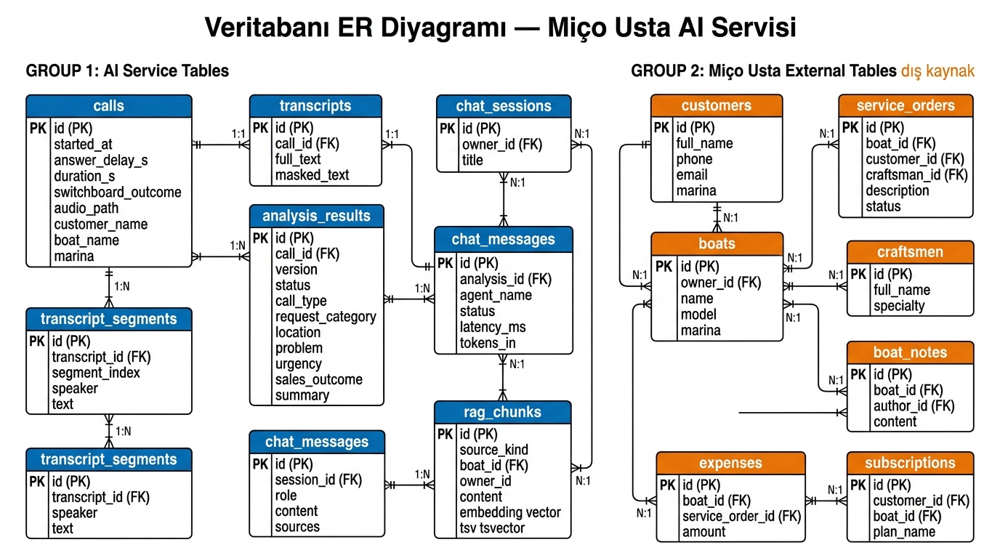
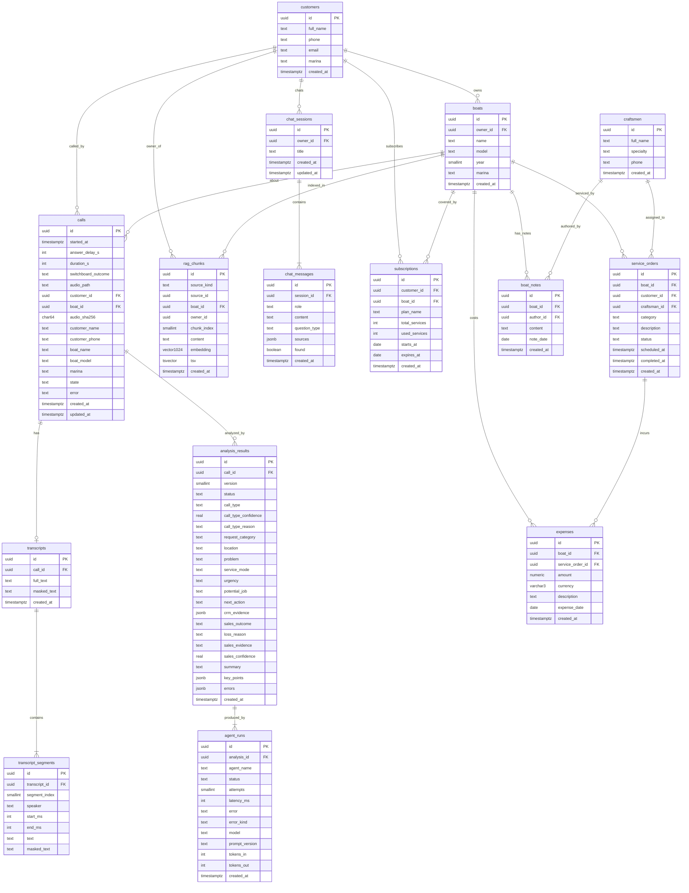

# Veritabanı Tablo Şeması

**Issue:** #5 · **Sürüm:** Taslak v1 · **Tarih:** 2026-10-11
**Kaynak:** Sistem mimarisi v3.1 §9, agent çıktı şemaları (#14), enum listeleri (#7)
**Uygulama:** modeller `backend/app/db/models/`, migration `backend/migrations/versions/` (#6). Bu belge ile modeller arasındaki fark testlerle yakalanır (`tests/test_db_schema.py`).

> Sütun adları **İngilizce**, açıklamalar **Türkçe**'dir.
> 🔶 işaretli tablolar **dış kaynak**tır — Miço Usta'nın gerçek şeması hocadan alınca değişebilir.

---

## 1. Enum Stratejisi

**Karar: `TEXT` sütun + `CHECK` kısıtlaması.**

PostgreSQL `CREATE TYPE ... AS ENUM` yerine `TEXT + CHECK` tercih edilmiştir çünkü:

- Yeni değer eklemek `ALTER TABLE ... DROP/ADD CONSTRAINT` ile yapılır; `ALTER TYPE ... ADD VALUE` geri alınamaz (transaction içinde rollback olmaz).
- Geliştirme sürecinde enum değerleri sık değişebilir (#7 henüz kesinleşmedi).
- Uygulama tarafında doğrulama zaten Pydantic `StrEnum` ile yapılıyor (`backend/app/domain/enums.py`).

Enum değerlerinin tam listesi [§7'de](#7-enum-değerleri-referansı) verilmiştir.

---

## 2. ER Diyagramı





---

## 3. Tablolar — Grup 1: AI Servisi

### 3.1 `calls`

Çağrı meta verisi. Ses dosyası yüklendikten sonra oluşturulur.

| Sütun | Tip | Zorunlu | Varsayılan | Açıklama |
|-------|-----|---------|------------|----------|
| `id` | `UUID` | ✅ | `gen_random_uuid()` | Birincil anahtar |
| `started_at` | `TIMESTAMPTZ` | ✅ | — | Çağrının başladığı zaman |
| `answer_delay_s` | `INTEGER` | — | — | Cevap süresi (saniye); çağrının kaç saniyede açıldığı |
| `duration_s` | `INTEGER` | — | — | Çağrı süresi (saniye) |
| `switchboard_outcome` | `TEXT` | — | — | Santral sonucu. CHECK: `randevu_olusturuldu`, `usta_yonlendirildi`, `kayit_olusturuldu`, `bilgi_verildi`, `geri_aranacak`, `iptal` |
| `audio_path` | `TEXT` | — | — | Storage'taki ses dosyası yolu (ör. `call-audio/call_001.wav`) |
| `audio_sha256` | `CHAR(64)` | — | — | Ses dosyasının SHA-256 özeti; aynı dosya tekrar yüklenirse uyarı verilir |
| `customer_id` | `UUID` | — | — | `customers(id)` FK; arayan müşteri **eşleştirilince** doldurulur (CRM kaydı ve servis emri önerisi için). Eşleşme yoksa `NULL` |
| `boat_id` | `UUID` | — | — | `boats(id)` FK; konuşulan tekne eşleştirilince doldurulur, yoksa `NULL` |
| `customer_name` | `TEXT` | — | — | Arayan müşteri adı (çağrı bilgisinden) |
| `customer_phone` | `TEXT` | — | — | Müşteri telefon numarası |
| `boat_name` | `TEXT` | — | — | Tekne adı |
| `boat_model` | `TEXT` | — | — | Tekne modeli (ör. Jeanneau Sun Odyssey 440) |
| `marina` | `TEXT` | — | — | Marina adı (ör. Tuzla Marina) |
| `state` | `TEXT` | ✅ | `'beklemede'` | İşlenme durumu: `beklemede`, `yaziya_cevriliyor`, `isleniyor`, `tamam`, `kismi`, `basarisiz` (#48) |
| `error` | `TEXT` | — | — | `state = basarisiz` ise nedeni |
| `created_at` | `TIMESTAMPTZ` | ✅ | `now()` | Kayıt oluşturma zamanı |
| `updated_at` | `TIMESTAMPTZ` | ✅ | `now()` | Son güncelleme zamanı |

**Kısıtlamalar:**
- `PK (id)`
- `UNIQUE (audio_sha256)` — aynı dosyanın tekrar yüklenmesini engeller
- `FK (customer_id) REFERENCES customers(id)`, `FK (boat_id) REFERENCES boats(id)` (ikisi de `ON DELETE SET NULL`)
- `CHECK (switchboard_outcome IN (...))` — geçerli santral sonuçları
- `CHECK (state IN (...))` — geçerli işlenme durumları (API sözleşmesindeki `CallState`)

---

### 3.2 `transcripts`

Çağrının tam transkripti. Her çağrının en fazla bir transkripti olur.

| Sütun | Tip | Zorunlu | Varsayılan | Açıklama |
|-------|-----|---------|------------|----------|
| `id` | `UUID` | ✅ | `gen_random_uuid()` | Birincil anahtar |
| `call_id` | `UUID` | ✅ | — | `calls(id)` FK; her çağrının bir transkripti |
| `full_text` | `TEXT` | ✅ | — | Tüm konuşmanın birleştirilmiş ham metni |
| `masked_text` | `TEXT` | — | — | PII maskelenmiş metin (LLM ve RAG yalnızca bunu görür) |
| `created_at` | `TIMESTAMPTZ` | ✅ | `now()` | Kayıt oluşturma zamanı |

**Kısıtlamalar:**
- `PK (id)`
- `FK (call_id) REFERENCES calls(id) ON DELETE CASCADE`
- `UNIQUE (call_id)` — bir çağrıya bir transkript

---

### 3.3 `transcript_segments`

Konuşmanın konuşmacıya göre ayrılmış parçaları.

| Sütun | Tip | Zorunlu | Varsayılan | Açıklama |
|-------|-----|---------|------------|----------|
| `id` | `UUID` | ✅ | `gen_random_uuid()` | Birincil anahtar |
| `transcript_id` | `UUID` | ✅ | — | `transcripts(id)` FK |
| `segment_index` | `SMALLINT` | ✅ | — | Sıra numarası (0'dan başlar) |
| `speaker` | `TEXT` | ✅ | — | Konuşmacı. CHECK: `customer`, `rep` |
| `start_ms` | `INTEGER` | — | — | Segmentin başlangıç zamanı (milisaniye) |
| `end_ms` | `INTEGER` | — | — | Segmentin bitiş zamanı (milisaniye) |
| `text` | `TEXT` | ✅ | — | Ham metin |
| `masked_text` | `TEXT` | — | — | PII maskelenmiş metin |

**Kısıtlamalar:**
- `PK (id)`
- `FK (transcript_id) REFERENCES transcripts(id) ON DELETE CASCADE`
- `UNIQUE (transcript_id, segment_index)`
- `CHECK (speaker IN ('customer', 'rep'))`
- `CHECK (start_ms IS NULL OR end_ms IS NULL OR end_ms >= start_ms)`

---

### 3.4 `analysis_results`

Dört agent'ın birleşik çıktısı. Yeniden analiz yapılırsa aynı `call_id` ile yeni `version` satırı eklenir.

| Sütun | Tip | Zorunlu | Varsayılan | Açıklama |
|-------|-----|---------|------------|----------|
| `id` | `UUID` | ✅ | `gen_random_uuid()` | Birincil anahtar |
| `call_id` | `UUID` | ✅ | — | `calls(id)` FK |
| `version` | `SMALLINT` | ✅ | `1` | Analiz sürümü; yeniden analiz yeni satır oluşturur |
| `status` | `TEXT` | ✅ | — | CHECK: `tamam`, `kismi`, `basarisiz` |
| — | — | — | — | **Çağrı Sınıflandırma Agent'ı** |
| `call_type` | `TEXT` | — | — | Çağrı tipi. CHECK: enum `CallType` |
| `call_type_confidence` | `REAL` | — | — | Sınıflandırma güveni (0–1) |
| `call_type_reason` | `TEXT` | — | — | Kararın gerekçesi |
| — | — | — | — | **CRM Bilgi Çıkarım Agent'ı** |
| `request_category` | `TEXT` | — | — | Talep kategorisi. CHECK: enum `RequestCategory` |
| `location` | `TEXT` | — | — | Marina veya lokasyon |
| `problem` | `TEXT` | — | — | Sorunun kısa tarifi |
| `service_mode` | `TEXT` | — | — | Hizmet biçimi. CHECK: enum `ServiceMode` |
| `urgency` | `TEXT` | — | — | Aciliyet. CHECK: enum `Urgency` |
| `potential_job` | `TEXT` | — | — | Doğacak olası iş |
| `next_action` | `TEXT` | — | — | Sonraki aksiyon. CHECK: enum `NextAction` |
| `crm_evidence` | `JSONB` | — | `'{}'` | Alan adı → konuşmadan alıntı |
| — | — | — | — | **Satış Analiz Agent'ı** |
| `sales_outcome` | `TEXT` | — | — | Satış sonucu. CHECK: enum `SalesOutcomeType` |
| `loss_reason` | `TEXT` | — | — | Kayıp nedeni (yalnızca `kaybedildi` iken). CHECK: enum `LossReason` |
| `sales_evidence` | `TEXT` | — | — | Kararı destekleyen alıntı |
| `sales_confidence` | `REAL` | — | — | Satış kararının güveni (0–1) |
| — | — | — | — | **Özetleme Agent'ı** |
| `summary` | `TEXT` | — | — | Görüşmenin en fazla 3 cümlelik özeti |
| `key_points` | `JSONB` | — | `'[]'` | En fazla 3 kısa madde (JSON dizisi) |
| — | — | — | — | **Meta** |
| `errors` | `JSONB` | — | `'{}'` | Agent adı → hata mesajı (kısmi/başarısız durumda) |
| `created_at` | `TIMESTAMPTZ` | ✅ | `now()` | Kayıt oluşturma zamanı |

**Kısıtlamalar:**
- `PK (id)`
- `FK (call_id) REFERENCES calls(id) ON DELETE CASCADE`
- `UNIQUE (call_id, version)`
- `CHECK (status IN ('tamam', 'kismi', 'basarisiz'))`
- `CHECK (call_type IS NULL OR call_type IN ('yeni_musteri', 'servis', 'teklif', 'acil', 'bilgi'))`
- `CHECK (request_category IS NULL OR request_category IN ('makine', 'mekanik_hidrolik', 'elektrik_elektronik', 'su_sihhi_tesisat', 'iklimlendirme', 'tekne_guvenligi', 'temizlik_bakim', 'diger'))`
- `CHECK (service_mode IS NULL OR service_mode IN ('yerinde_servis', 'atolyede', 'uzaktan_destek'))`
- `CHECK (urgency IS NULL OR urgency IN ('dusuk', 'normal', 'yuksek', 'acil'))`
- `CHECK (next_action IS NULL OR next_action IN ('servis_randevusu_olustur', 'teklif_hazirla', 'geri_ara', 'bilgi_ver', 'usta_ata', 'aksiyon_yok'))`
- `CHECK (sales_outcome IS NULL OR sales_outcome IN ('satisa_donustu', 'kaybedildi', 'beklemede'))`
- `CHECK (loss_reason IS NULL OR loss_reason IN ('fiyat', 'gec_donus', 'rakip', 'takvim', 'guven', 'diger'))`
- `CHECK (loss_reason IS NULL OR sales_outcome = 'kaybedildi')` ve `CHECK (sales_outcome IS DISTINCT FROM 'kaybedildi' OR loss_reason IS NOT NULL)` — kayıp nedeni yalnızca `kaybedildi` iken dolu, `kaybedildi` iken zorunlu (`SalesAnalysis` şemasındaki kural)
- `CHECK (call_type_confidence IS NULL OR (call_type_confidence >= 0 AND call_type_confidence <= 1))`
- `CHECK (sales_confidence IS NULL OR (sales_confidence >= 0 AND sales_confidence <= 1))`

**Not:** CRM alanları (7 alan) konuşmada geçmezse `NULL` kalır; agent bilgi uydurmaz (bkz. `CrmExtraction` şeması).

---

### 3.5 `agent_runs`

Her agent çalışmasının kaydı. Orkestratör tarafından yazılır; süre, maliyet ve hata izleme için kullanılır.

| Sütun | Tip | Zorunlu | Varsayılan | Açıklama |
|-------|-----|---------|------------|----------|
| `id` | `UUID` | ✅ | `gen_random_uuid()` | Birincil anahtar |
| `analysis_id` | `UUID` | ✅ | — | `analysis_results(id)` FK |
| `agent_name` | `TEXT` | ✅ | — | Agent adı. CHECK: `call_classifier`, `crm_extraction`, `sales_analyzer`, `summarizer` (`backend/app/agents/names.py`) |
| `status` | `TEXT` | ✅ | — | Agent durumu. CHECK: `ok`, `failed`, `skipped` (`AgentResult.status`) |
| `attempts` | `SMALLINT` | ✅ | `1` | Deneme sayısı (ilk çalıştırma + yeniden denemeler) |
| `latency_ms` | `INTEGER` | — | — | Toplam süre (milisaniye) |
| `error` | `TEXT` | — | — | Hata mesajı (varsa) |
| `error_kind` | `TEXT` | — | — | Hata türü. CHECK: `validation` (şemaya uymadı), `runtime` (LLM/ağ/kod hatası), `timeout` (`AgentResult.error_kind`) |
| `model` | `TEXT` | — | — | Kullanılan LLM modeli |
| `prompt_version` | `TEXT` | — | — | Prompt sürümü (ölçüm takibi için) |
| `tokens_in` | `INTEGER` | ✅ | `0` | Giriş token sayısı |
| `tokens_out` | `INTEGER` | ✅ | `0` | Çıkış token sayısı |
| `created_at` | `TIMESTAMPTZ` | ✅ | `now()` | Çalıştırma zamanı |

**Kısıtlamalar:**
- `PK (id)`
- `FK (analysis_id) REFERENCES analysis_results(id) ON DELETE CASCADE`
- `CHECK (agent_name IN ('call_classifier', 'crm_extraction', 'sales_analyzer', 'summarizer'))`
- `CHECK (status IN ('ok', 'failed', 'skipped'))`
- `CHECK (error_kind IS NULL OR error_kind IN ('validation', 'runtime', 'timeout'))`

---

### 3.6 `chat_sessions`

Miço AI sohbet oturumları. Tekne sahibi başına birden fazla oturum olabilir.

| Sütun | Tip | Zorunlu | Varsayılan | Açıklama |
|-------|-----|---------|------------|----------|
| `id` | `UUID` | ✅ | `gen_random_uuid()` | Birincil anahtar |
| `owner_id` | `UUID` | ✅ | — | Tekne sahibi; `customers(id)` FK. Yetkilendirme bu sütunla yapılır |
| `title` | `TEXT` | — | — | Oturum başlığı (ilk sorudan otomatik üretilir) |
| `created_at` | `TIMESTAMPTZ` | ✅ | `now()` | Oluşturma zamanı |
| `updated_at` | `TIMESTAMPTZ` | ✅ | `now()` | Son mesaj zamanı |

**Kısıtlamalar:**
- `PK (id)`
- `FK (owner_id) REFERENCES customers(id)`

---

### 3.7 `chat_messages`

Sohbet mesajları ve kaynak referansları.

| Sütun | Tip | Zorunlu | Varsayılan | Açıklama |
|-------|-----|---------|------------|----------|
| `id` | `UUID` | ✅ | `gen_random_uuid()` | Birincil anahtar |
| `session_id` | `UUID` | ✅ | — | `chat_sessions(id)` FK |
| `role` | `TEXT` | ✅ | — | Mesaj rolü. CHECK: `user`, `assistant` |
| `content` | `TEXT` | ✅ | — | Mesaj içeriği |
| `question_type` | `TEXT` | — | — | Soru tipi (yalnızca assistant). CHECK: `gecmis_oneri`, `sayisal`, `kapsam_disi` |
| `sources` | `JSONB` | — | `'[]'` | Kaynak referansları (SourceRef dizisi) |
| `found` | `BOOLEAN` | — | `true` | `false`: kayıtlarda bilgi bulunamadı |
| `created_at` | `TIMESTAMPTZ` | ✅ | `now()` | Mesaj zamanı |

**Kısıtlamalar:**
- `PK (id)`
- `FK (session_id) REFERENCES chat_sessions(id) ON DELETE CASCADE`
- `CHECK (role IN ('user', 'assistant'))`
- `CHECK (question_type IS NULL OR question_type IN ('gecmis_oneri', 'sayisal', 'kapsam_disi'))`

---

### 3.8 `rag_chunks`

Tekne karnesi, usta notları, giderler ve abonelik verilerinin RAG için parçalanmış ve gömülü hâli.

| Sütun | Tip | Zorunlu | Varsayılan | Açıklama |
|-------|-----|---------|------------|----------|
| `id` | `UUID` | ✅ | `gen_random_uuid()` | Birincil anahtar |
| `source_kind` | `TEXT` | ✅ | — | Kaynak türü. CHECK: `service_record`, `boat_note`, `expense`, `subscription` |
| `source_id` | `UUID` | ✅ | — | Kaynağın orijinal tablosundaki ID'si (`source_kind`'a göre `service_orders`, `boat_notes`, `expenses` veya `subscriptions`). Birden fazla tabloya işaret ettiği için FK **tanımlanmaz**; tutarlılık indeksleme sürecinde sağlanır |
| `boat_id` | `UUID` | — | — | İlişkili tekne; `boats(id)` FK |
| `owner_id` | `UUID` | ✅ | — | Tekne sahibi; `customers(id)` FK. **Yetkilendirme** bu sütunla yapılır |
| `chunk_index` | `SMALLINT` | ✅ | `0` | Aynı kaynağın kaçıncı parçası |
| `content` | `TEXT` | ✅ | — | Parça metni |
| `embedding` | `vector(1024)` | — | — | bge-m3 gömme vektörü |
| `tsv` | `tsvector` | — | — | Türkçe tam metin arama vektörü. Öneri: `GENERATED ALWAYS AS (to_tsvector('turkish', content)) STORED` |
| `created_at` | `TIMESTAMPTZ` | ✅ | `now()` | Oluşturma zamanı |

**Kısıtlamalar:**
- `PK (id)`
- `FK (boat_id) REFERENCES boats(id)`, `FK (owner_id) REFERENCES customers(id)`
- `UNIQUE (source_kind, source_id, chunk_index)` — aynı parça tekrar eklenmez
- `CHECK (source_kind IN ('service_record', 'boat_note', 'expense', 'subscription'))`

---

### 3.9 `crm_reviews`

Analiz çıktısından üretilen CRM önerisinin admin tarafından incelenmesi (onay, red veya düzenleyerek onay) kaydı (#106). İnceleme analiz sürümüne bağlıdır.

| Sütun | Tip | Zorunlu | Varsayılan | Açıklama |
|-------|-----|---------|------------|----------|
| `id` | `UUID` | ✅ | `gen_random_uuid()` | Birincil anahtar |
| `analysis_id` | `UUID` | ✅ | — | `analysis_results(id)` FK; incelenen analiz sürümü (UNIQUE) |
| `call_id` | `UUID` | ✅ | — | `calls(id)` FK; çağrı referansı |
| `status` | `TEXT` | ✅ | `'bekliyor'` | İnceleme durumu. CHECK: `bekliyor`, `onaylandi`, `reddedildi` |
| `edited_fields` | `JSONB` | ✅ | `'{}'::jsonb` | Yalnızca admin tarafından düzenlenen 7 CRM alanı |
| `note` | `TEXT` | — | — | Red nedeni veya onay notu |
| `reviewed_at` | `TIMESTAMPTZ` | — | — | İncelenme zamanı |
| `service_order_id` | `UUID` | — | — | `service_orders(id)` FK; onayda oluşturulan servis emri |
| `created_at` | `TIMESTAMPTZ` | ✅ | `now()` | Oluşturma zamanı |
| `updated_at` | `TIMESTAMPTZ` | ✅ | `now()` | Güncelleme zamanı |

**Kısıtlamalar:**
- `PK (id)`
- `UNIQUE (analysis_id)`
- `FK (analysis_id) REFERENCES analysis_results(id) ON DELETE CASCADE`
- `FK (call_id) REFERENCES calls(id) ON DELETE CASCADE`
- `FK (service_order_id) REFERENCES service_orders(id) ON DELETE SET NULL`
- `CHECK (status IN ('bekliyor', 'onaylandi', 'reddedildi'))`

---

## 4. Tablolar — Grup 2: Miço Usta (🔶 Dış Kaynak)

> **⚠️ Bu tablolar varsayımdır.** Gerçek şema hocadan alınca güncellenecektir.
> Şimdilik sentetik veriye (#23) uygun tasarlanmıştır.
> AI servisi bu tabloları **yalnızca okur**, yazmaz.

### 4.1 🔶 `customers`

Tekne sahipleri (müşteriler).

| Sütun | Tip | Zorunlu | Varsayılan | Açıklama |
|-------|-----|---------|------------|----------|
| `id` | `UUID` | ✅ | `gen_random_uuid()` | Birincil anahtar |
| `full_name` | `TEXT` | ✅ | — | Ad soyad |
| `phone` | `TEXT` | — | — | Telefon numarası |
| `email` | `TEXT` | — | — | E-posta |
| `marina` | `TEXT` | — | — | Bağlı olduğu marina |
| `created_at` | `TIMESTAMPTZ` | ✅ | `now()` | Kayıt oluşturma zamanı |

---

### 4.2 🔶 `boats`

Tekneler. Her tekne bir müşteriye (`owner_id`) aittir.

| Sütun | Tip | Zorunlu | Varsayılan | Açıklama |
|-------|-----|---------|------------|----------|
| `id` | `UUID` | ✅ | `gen_random_uuid()` | Birincil anahtar |
| `owner_id` | `UUID` | ✅ | — | `customers(id)` FK; tekne sahibi |
| `name` | `TEXT` | ✅ | — | Tekne adı (ör. Rüzgar) |
| `model` | `TEXT` | — | — | Model (ör. Jeanneau Sun Odyssey 440) |
| `year` | `SMALLINT` | — | — | Üretim yılı |
| `marina` | `TEXT` | — | — | Bağlı olduğu marina |
| `created_at` | `TIMESTAMPTZ` | ✅ | `now()` | Kayıt oluşturma zamanı |

**Kısıtlamalar:**
- `FK (owner_id) REFERENCES customers(id)`

---

### 4.3 🔶 `service_orders`

Servis emirleri. Bir teknede yapılacak/yapılmış iş.

| Sütun | Tip | Zorunlu | Varsayılan | Açıklama |
|-------|-----|---------|------------|----------|
| `id` | `UUID` | ✅ | `gen_random_uuid()` | Birincil anahtar |
| `boat_id` | `UUID` | ✅ | — | `boats(id)` FK |
| `customer_id` | `UUID` | ✅ | — | `customers(id)` FK |
| `craftsman_id` | `UUID` | — | — | `craftsmen(id)` FK; atanan usta |
| `category` | `TEXT` | — | — | İşin kategorisi. CHECK: enum `RequestCategory`. Miço AI'nın `get_last_maintenance(category=...)` aracı bunu kullanır |
| `description` | `TEXT` | — | — | Servis açıklaması (yapılan iş) |
| `status` | `TEXT` | ✅ | `'yeni_atandi'` | Servis emri durumu (Miço Usta iş akışı). CHECK: `yeni_atandi`, `kesifte`, `onaylandi`, `devam_ediyor`, `tamamlandi` |
| `scheduled_at` | `TIMESTAMPTZ` | — | — | Planlanan tarih |
| `completed_at` | `TIMESTAMPTZ` | — | — | Tamamlanma tarihi |
| `source_call_id` | `UUID` | — | — | `calls(id)` FK; servis emrinin doğduğu kaynak çağrı (#106) |
| `created_at` | `TIMESTAMPTZ` | ✅ | `now()` | Kayıt oluşturma zamanı |

**Kısıtlamalar:**
- `FK (boat_id) REFERENCES boats(id)`
- `FK (customer_id) REFERENCES customers(id)`
- `FK (craftsman_id) REFERENCES craftsmen(id)`
- `FK (source_call_id) REFERENCES calls(id) ON DELETE SET NULL`
- `CHECK (status IN ('yeni_atandi', 'kesifte', 'onaylandi', 'devam_ediyor', 'tamamlandi'))`
- `CHECK (category IS NULL OR category IN ('makine', 'mekanik_hidrolik', 'elektrik_elektronik', 'su_sihhi_tesisat', 'iklimlendirme', 'tekne_guvenligi', 'temizlik_bakim', 'diger'))`

---

### 4.4 🔶 `craftsmen`

Ustalar (teknisyenler).

| Sütun | Tip | Zorunlu | Varsayılan | Açıklama |
|-------|-----|---------|------------|----------|
| `id` | `UUID` | ✅ | `gen_random_uuid()` | Birincil anahtar |
| `full_name` | `TEXT` | ✅ | — | Ad soyad |
| `specialty` | `TEXT` | — | — | Uzmanlık alanı (ör. motor, elektrik) |
| `phone` | `TEXT` | — | — | Telefon numarası |
| `created_at` | `TIMESTAMPTZ` | ✅ | `now()` | Kayıt oluşturma zamanı |

---

### 4.5 🔶 `boat_notes`

Ustanın tekneye düştüğü notlar (tekne karnesi). Miço AI bu notları RAG ile arar.

| Sütun | Tip | Zorunlu | Varsayılan | Açıklama |
|-------|-----|---------|------------|----------|
| `id` | `UUID` | ✅ | `gen_random_uuid()` | Birincil anahtar |
| `boat_id` | `UUID` | ✅ | — | `boats(id)` FK |
| `author_id` | `UUID` | — | — | `craftsmen(id)` FK; notu yazan usta |
| `content` | `TEXT` | ✅ | — | Not içeriği |
| `note_date` | `DATE` | — | — | Notun ilgili olduğu tarih |
| `created_at` | `TIMESTAMPTZ` | ✅ | `now()` | Kayıt oluşturma zamanı |

**Kısıtlamalar:**
- `FK (boat_id) REFERENCES boats(id)`
- `FK (author_id) REFERENCES craftsmen(id)`

---

### 4.6 🔶 `expenses`

Tekne giderleri. Miço AI "bu ay ne kadar harcadım" gibi soruları buradan cevaplar.

| Sütun | Tip | Zorunlu | Varsayılan | Açıklama |
|-------|-----|---------|------------|----------|
| `id` | `UUID` | ✅ | `gen_random_uuid()` | Birincil anahtar |
| `boat_id` | `UUID` | ✅ | — | `boats(id)` FK |
| `service_order_id` | `UUID` | — | — | `service_orders(id)` FK; varsa ilişkili servis emri |
| `amount` | `NUMERIC(12,2)` | ✅ | — | Tutar |
| `currency` | `VARCHAR(3)` | ✅ | `'TRY'` | Para birimi (ISO 4217) |
| `description` | `TEXT` | — | — | Gider açıklaması |
| `expense_date` | `DATE` | — | — | Gider tarihi |
| `created_at` | `TIMESTAMPTZ` | ✅ | `now()` | Kayıt oluşturma zamanı |

**Kısıtlamalar:**
- `FK (boat_id) REFERENCES boats(id)`
- `FK (service_order_id) REFERENCES service_orders(id)`
- `CHECK (amount >= 0)`

---

### 4.7 🔶 `subscriptions`

Bakım paketleri / abonelikler. Miço AI "kalan paket hakkım ne kadar" sorusunu buradan cevaplar.

| Sütun | Tip | Zorunlu | Varsayılan | Açıklama |
|-------|-----|---------|------------|----------|
| `id` | `UUID` | ✅ | `gen_random_uuid()` | Birincil anahtar |
| `customer_id` | `UUID` | ✅ | — | `customers(id)` FK |
| `boat_id` | `UUID` | — | — | `boats(id)` FK; paketin geçerli olduğu tekne |
| `plan_name` | `TEXT` | ✅ | — | Paket adı (ör. Yıllık Bakım Paketi) |
| `total_services` | `INTEGER` | ✅ | — | Paketin kapsamındaki toplam servis hakkı |
| `used_services` | `INTEGER` | ✅ | `0` | Kullanılan servis hakkı |
| `starts_at` | `DATE` | — | — | Başlangıç tarihi |
| `expires_at` | `DATE` | — | — | Bitiş tarihi |
| `created_at` | `TIMESTAMPTZ` | ✅ | `now()` | Kayıt oluşturma zamanı |

**Kısıtlamalar:**
- `FK (customer_id) REFERENCES customers(id)`
- `FK (boat_id) REFERENCES boats(id)`
- `CHECK (used_services >= 0 AND used_services <= total_services)`

---

## 5. İndeks Stratejisi

| Tablo | İndeks | Tip | Neden |
|-------|--------|-----|-------|
| `calls` | `ix_calls_started_at` | B-tree | Tarih aralığına göre KPI sorguları |
| `calls` | `uq_calls_audio_sha256` | Unique (B-tree) | Tekrar yükleme kontrolü |
| `calls` | `ix_calls_customer_id` | B-tree | Müşterinin çağrı geçmişi |
| `transcripts` | `uq_transcripts_call_id` | Unique (B-tree) | Bir çağrıya bir transkript |
| `transcript_segments` | `ix_segments_transcript_id` | B-tree | Segmentleri transkripte göre getirme |
| `analysis_results` | `ix_analysis_call_id` | B-tree | Çağrıya göre analiz sonuçlarını bulma |
| `analysis_results` | `ix_analysis_call_type` | B-tree | KPI: çağrı tipine göre gruplama |
| `analysis_results` | `ix_analysis_sales_outcome` | B-tree | KPI: satış sonucuna göre gruplama |
| `agent_runs` | `ix_runs_analysis_id` | B-tree | Analiz başına agent çalışmalarını listeleme |
| `chat_sessions` | `ix_sessions_owner_id` | B-tree | **Yetkilendirme**: sahibin oturumlarını bulma |
| `chat_messages` | `ix_messages_session_id` | B-tree | Oturumdaki mesajları sıralı getirme |
| `rag_chunks` | `ix_chunks_owner_id` | B-tree | **Yetkilendirme**: sahibin parçalarını filtreleme |
| `rag_chunks` | `ix_chunks_boat_id` | B-tree | Tekneye göre parça filtreleme |
| `rag_chunks` | `ix_chunks_embedding` | HNSW (`vector_cosine_ops`) | Vektör benzerlik araması (ANN) |
| `rag_chunks` | `ix_chunks_tsv` | GIN | Türkçe tam metin araması |
| `boats` | `ix_boats_owner_id` | B-tree | **Yetkilendirme**: sahibin teknelerini bulma |
| `service_orders` | `ix_orders_boat_id` | B-tree | Tekneye göre servis emirlerini listeleme |
| `boat_notes` | `ix_notes_boat_id` | B-tree | Tekneye göre notları listeleme |
| `expenses` | `ix_expenses_boat_id` | B-tree | Tekneye göre giderleri listeleme |
| `subscriptions` | `ix_subs_customer_id` | B-tree | Müşterinin aboneliklerini listeleme |

---

## 6. Yetkilendirme

Tekne sahibi yalnızca kendi verisini görür (Sistem mimarisi v3.1 §3):

- `chat_sessions.owner_id` → tekne sahibinin sohbet oturumları
- `rag_chunks.owner_id` → yalnızca sahibin teknelerine ait RAG parçaları döner
- `boats.owner_id` → sahibin tekneleri; ilişkili `service_orders`, `boat_notes`, `expenses`, `subscriptions` buradan süzülür

Sorgu örneği:
```sql
-- Tekne sahibinin RAG parçalarını getir
SELECT * FROM rag_chunks
WHERE owner_id = :current_owner_id
ORDER BY embedding <=> :query_vector
LIMIT 8;
```

> **Not:** `owner_id` filtresi HNSW indeksiyle birlikte kullanıldığında indeks önce en yakın komşuları, sonra filtreyi uygular ve `LIMIT`'ten az satır dönebilir. pgvector 0.8 ve üzerinde `SET hnsw.iterative_scan = relaxed_order;` bunu çözer. #26'da (hibrit arama) sürüm ve davranış denenmeli.

> **Not (CI'da görüldü):** PostgreSQL'in `turkish` kök bulucusu iyelik ekli biçimleri her zaman köke indiremiyor: `plainto_tsquery('turkish', 'filtre')`, "filtresi" geçen metni bulamadı. Tam metin araması tek başına Türkçe çekimlerde eksik kalır; #26'da vektör araması ile birlikte (hibrit) kullanılmalı.

---

## 7. Enum Değerleri Referansı

Kaynak: `backend/app/domain/enums.py`; tanımlar ve kurallar `docs/enums.md` (#7)

| Enum | Değerler |
|------|----------|
| `CallType` | `yeni_musteri`, `servis`, `teklif`, `acil`, `bilgi` |
| `RequestCategory` | `makine`, `mekanik_hidrolik`, `elektrik_elektronik`, `su_sihhi_tesisat`, `iklimlendirme`, `tekne_guvenligi`, `temizlik_bakim`, `diger` (Miço Usta hizmet kategorileri) |
| `ServiceOrderStatus` | `yeni_atandi`, `kesifte`, `onaylandi`, `devam_ediyor`, `tamamlandi` (Miço Usta iş akışı) |
| `ServiceMode` | `yerinde_servis`, `atolyede`, `uzaktan_destek` |
| `Urgency` | `dusuk`, `normal`, `yuksek`, `acil` |
| `NextAction` | `servis_randevusu_olustur`, `teklif_hazirla`, `geri_ara`, `bilgi_ver`, `usta_ata`, `aksiyon_yok` |
| `SalesOutcomeType` | `satisa_donustu`, `kaybedildi`, `beklemede` |
| `LossReason` | `fiyat`, `gec_donus`, `rakip`, `takvim`, `guven`, `diger` |
| `AnalysisStatus` | `tamam`, `kismi`, `basarisiz` |
| `SwitchboardOutcome` | `randevu_olusturuldu`, `usta_yonlendirildi`, `kayit_olusturuldu`, `bilgi_verildi`, `geri_aranacak`, `iptal` |
| `Speaker` | `customer`, `rep` |
| `ChatRole` | `user`, `assistant` |
| `QuestionType` | `gecmis_oneri`, `sayisal`, `kapsam_disi` |
| `AgentName` | `call_classifier`, `crm_extraction`, `sales_analyzer`, `summarizer` |
| `AgentStatus` | `ok`, `failed`, `skipped` |
| `AgentErrorKind` | `validation`, `runtime`, `timeout` |
| `SourceKind` | `service_record`, `boat_note`, `expense`, `subscription` |
